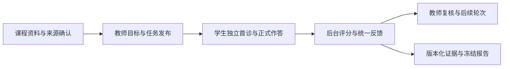

<div align="center">

# 阿克西斯 · 智慧学伴

**把课程要求、学习证据与下一步学习安排连接起来。**

第二届北京市大学生“人工智能+”创新大赛 · 第 10 题<br>
智慧学伴学情诊断与个性化学习智能体构建

[](LICENSE)

[赛题与成果](#赛题与成果) · [当前能力](#当前能力) · [验证记录](#验证记录) · [快速开始](#快速开始) · [文档导航](#文档导航)

</div>

智慧学伴面向教师与学生：教师依据课程资料和学习表现确定跟进目标，学生完成诊断、练习与提交，学习结果再回到教师的复核与后续安排中。项目重点是让判断有依据、任务能落实、结果可追溯。

> **当前阶段：正式后端流程已完成本地验证，师生前端与正式参赛成果仍在制作。**
>
> 默认运行 `/api/v1` 正式后端；现有网页演示使用独立的虚构样例。真实模型、赛事数据适配与教学效果尚未完成验收。状态更新依据：2026-11-12 的[实际流程验证记录](docs/后端重构统一测试结果.md)。

## 赛题与成果

### 评审阅读入口

| 需要了解的内容 | 阅读入口 |
| --- | --- |
| 赛题任务、交付规格与数据边界 | [赛题要求与数据边界](docs/赛题要求与数据边界.md) |
| 产品为什么这样设计，首版要完成什么 | [产品与前后端技术总方案](docs/智慧学伴产品与前后端技术总方案.md) |
| 哪些是需求、设计与待验收条件 | [需求覆盖与多轮复核清单](docs/需求覆盖与复核清单.md) |
| 当前代码实际跑通了什么 | [后端修复与实际流程验证结果](docs/后端重构统一测试结果.md) |
| 三名代表学生、两班比较与展示安排 | [制作方向与案例组织](docs/制作方向/README.md) |

### 三项任务对应关系

参赛成果需基于赛方提供的课程要求、配套材料及模拟学情数据。当前合成测试和虚构演示用于开发验证，正式三任务成果仍需独立制作与核对。

| 赛题任务 | 当前实现基础 | 正式成果待补齐 |
| --- | --- | --- |
| 学习内容与要求梳理 | 资料上传、来源定位、许可及可见块确认；课程要求与知识点的关联存储 | 指定资料的内容、要求、必要联系与出处，形成可核对的梳理结果 |
| 学生学习情况分析 | 版本化作答与评分、首答/重做/帮助记录、证据汇总及四类冻结报告 | 正式数据字段映射、统计复算，三名代表学生及 DC01/DC02 两班同口径比较 |
| 个性化学习建议 | 教师目标与轮次发布、独立首诊、有限轮数持续计划、异议与教师更正 | 基于正式案例的具体材料、理由、顺序、分步提示及后续观察条件；完成内容与教学质量复核 |

缺少记录不视为答错，证据不足时保留“不足以判断”的结果；当前掌握度默认规则仍待真实教学数据校准。

### 提交材料状态

以下按仓库现有文件标注。方案稿用于指导制作，正式提交以赛方最新模板与通知为准。

| 材料 | 提交要求 | 当前状态与入口 |
| --- | --- | --- |
| 设计方案 PDF | 不超过 20 页 | **待完成**；已有[产品技术总方案](docs/智慧学伴产品与前后端技术总方案.md)作为编制依据 |
| 三项任务成果包 | JSON、CSV 等机读结果，附字段说明、输入输出样例和操作说明 | **待完成**；已验证报告导出能力，正式赛事三任务结果包尚未交付 |
| 演示视频 | MP4，5 分钟以内 | **待完成**；内容组织见[制作方向](docs/制作方向/README.md) |
| 现场答辩 PPT | 讲解 10 分钟、答辩 5 分钟 | **待完成**；本地已有比赛展示型 PPT 制作方案，待发布，见下方说明 |
| 分析脚本或代码 | 可选提交，关键结果须可核对 | 当前仓库提供实现、测试和[真实 HTTP 流程脚本](server/tests/run_platform_flow.py)；不替代规定成果包 |

比赛展示型 PPT 制作方案的本地文件为 `docs/智慧学伴比赛展示型PPT制作方案.md`，包含 12 页主讲结构、录屏分镜、素材需求及制作步骤。该稿尚未随仓库发布；12 页为制作建议，20 页限制属于设计方案 PDF。

## 当前能力



| 能力 | 当前实现与验证范围 |
| --- | --- |
| 账号与授权 | Cookie 登录、教师申请审核、学生建号激活与密码重置；课程资料和班级学情分别授权 |
| 资料与题目 | 私有原件保存、来源锚点、许可与可见范围确认；题目版本冻结。真实模型出题/审题质量待验收 |
| 学习流程 | 幂等发布、独立首诊、编辑租约、草稿与正式提交分离、重复请求检查；持续计划在已确认题池、轮数和期限内推进 |
| 评分与复核 | 后台客观评分、成绩与答案统一开放、异议程序复核转教师、追加更正；保留原答、原分和修订历史 |
| 报告与导出 | 班级、个人、目标、题库四类范围；同一冻结快照导出 HTML、PDF、XLSX、JSON 和多表 CSV ZIP |
| 持久化与恢复 | platform、learning、jobs、content、reports、companion 六库；附件、schema 和 SHA256 校验，隔离恢复后重启复验 |

技术基础为 Python、FastAPI、SQLite WAL 和应用后台 worker。正式接口与数据布局见[正式后端接入说明](docs/decisions-backend-platform.md)。

## 验证记录

以下为 **2026-11-12 已执行的本地验证记录**，包含本轮 XML/SQL 改写后的完整回归和真实 HTTP 复验。测试数、HTTP 请求数和教学效果是不同的验证对象。

| 验证层次 | 记录结果 | 范围说明 |
| --- | --- | --- |
| 完整后端回归 | **345 项通过，0 失败、0 errors** | 107.641 秒；包含元数据序列化、外部关系及恶意 XML 拒绝回归 |
| 正式服务真实 HTTP | **27 阶段通过，399 次请求** | 实际 uvicorn、Cookie、SQLite 和后台 worker；请求数含轮询 |
| 资料草稿更新 | **特殊字符与权限字段保留，越权和旧版本请求拒绝** | 经正式 HTTP 修改，并在恢复实例核对资料一致 |
| 持续计划与恢复 | **60.688 秒后自动发布下一轮；六库恢复后重启读取通过** | 核对 4 个账号登录、4 个任务、成绩、两份历史报告修订及上传资料 |

实际流程覆盖：教师/课程审核 → 学生激活登录 → 资料确认 → 首诊 → 发布与草稿提交 → 后台评分 → 报告生成及五格式下载 → 异议与更正 → 下一轮自动发布 → 停写备份、恢复和重启读取。还验证了故障回滚与重试、越权拒绝、重复提交去重，以及同一冻结报告跨秒导出 XLSX 字节一致。

HTTP 验证预置五道合成已审核客观题，未调用真实模型。完整命令、失败修正记录、证据位置及未覆盖路径见[验证结果](docs/后端重构统一测试结果.md)。

## 快速开始

本地说明以 **Windows PowerShell、Python 3.11+** 为例，最近验证环境为 Python 3.12。所有命令从仓库根目录开始；启动脚本只监听本机回环地址。

### 1. 安装依赖

```powershell
python -m venv server/.venv
.\server\.venv\Scripts\python.exe -m pip install -r server/requirements.txt
```

### 2. 初始化正式实例

在同一个 PowerShell 窗口设置独立数据目录。相对 `DATA_DIR` 始终基于 `server/` 解析，下面的数据保存于 `server/data/platform/`。

```powershell
$env:SKIP_ENV_FILE = "1"
$env:APP_ENV = "development"
$env:STUDY_DEMO_ENABLED = "false"
$env:STUDY_WORKER_ENABLED = "true"
$env:DATA_DIR = "./data/platform"
$env:COOKIE_SECURE = "false"
$env:STUDY_COMPANION_PORT = "8000"

Push-Location server
.\.venv\Scripts\python.exe -m app.init_admin --username your-admin --display-name 管理员
Pop-Location
```

密码由终端隐藏输入两次，要求 12—128 个字符；没有默认管理员或默认密码。初始化仅在全新实例首次执行，已有管理员时会拒绝重复创建。

`SKIP_ENV_FILE=1` 表示忽略本地 `.env`。需要模型或知识库时按 [server/.env.example](server/.env.example) 配置，并另行核验数据许可、价格和预算；已有的系统环境变量仍然有效。

### 3. 启动并检查

继续在同一窗口、仓库根目录运行：

```powershell
.\start_study_companion.bat
```

- [服务状态](http://127.0.0.1:8000/)：正式模式返回 JSON，包含 `/api/v1` 入口提示。
- [健康检查](http://127.0.0.1:8000/health)：返回 `mode: platform` 和 worker 状态。
- 正式师生工作区尚未接入；完整后端操作示例由下一节真实 HTTP 脚本提供。

正式写请求需要同源 `Origin`，如 `http://127.0.0.1:8000`，认证使用 Cookie。关闭终端前按 `Ctrl+C` 停止服务。

<details>
<summary><strong>查看旧网页样例：独立端口与数据目录</strong></summary>

另开 PowerShell，在仓库根目录运行：

```powershell
$env:SKIP_ENV_FILE = "1"
$env:APP_ENV = "development"
$env:STUDY_DEMO_ENABLED = "true"
$env:STUDY_PERSISTENCE_ENABLED = "true"
$env:STUDY_DATA_DIR = "./data/demo"
$env:STUDY_COMPANION_PORT = "8001"
.\start_study_companion.bat
```

打开[虚构样例网页](http://127.0.0.1:8001/)。此实例使用 `/api/study/*` 和 `/api/teaching/*` 演示路由，数据与正式六库分开；本地角色切换不代表正式登录。旧流程说明见[教学流程接入记录](docs/decisions-teaching-flow.md)。

</details>

## 复现验证

在仓库根目录运行完整隔离回归：

```powershell
.\server\.venv\Scripts\python.exe -I -B server/tests/run_tests.py
```

运行真实 HTTP 业务流程及恢复后复验：

```powershell
.\server\.venv\Scripts\python.exe -I -B server/tests/run_platform_flow.py
```

真实 HTTP 脚本自行选择本机端口，启动正式服务及后台 worker；使用新临时数据库，结束后清理账号和数据库，并输出脱敏 `evidence.json` 的位置。脚本显式禁用模型、MaxKB 上游，持续计划按真实时钟等待约 60 秒。

需要保留证据时可加 `--output-dir server/artifacts/your-new-run`，目标目录必须不存在。六库备份为逐库快照；实际业务备份应先停写，不保证持续跨库写入时的同一业务时点。

## 当前边界与下一步

| 待完成事项 | 对当前使用的影响 |
| --- | --- |
| 正式师生前端接入 | 后端可通过 API 操作；网页与手机端的完整使用体验待验收 |
| 真实模型、MaxKB、SSE 与账单 | 已有适配与相关程序测试，真实线路、出题/审题/主观评分质量及成本尚未验收 |
| 正式赛事数据与成果 | 三项任务结果、三名代表学生、两班比较和独立评测仍需基于获准资料完成 |
| 语音、扫描资料与开放式辅导 | ASR 当前明确返回 503；扫描资料需人工核对，开放式逐步提示仍待防泄题及教学质量验证 |
| 真实教学效果与规则校准 | 无提分率、效率提升或长期教学效果结论；默认掌握度参数未经实证校准 |

最近验证没有新增报告视觉验收；人工评分、目标关闭/续期等部分路径未纳入该次真实 HTTP 整链。旧快照提供只读解码与 dry-run，真实账号绑定和旧事实导入仍禁用。安全检查的剩余告警与覆盖限制详见验证记录，不据此宣称完成全面安全审计。

优先推进正式前端接入、获准资料的三任务成果、真实模型与内容评测，再完成视频、设计方案和答辩材料。完整产品方向以[产品技术总方案](docs/智慧学伴产品与前后端技术总方案.md)为准。

## 文档导航

| 文档 | 用途 |
| --- | --- |
| [赛题要求与数据边界](docs/赛题要求与数据边界.md) | 核心任务、提交规格、规则依据与待确认事项 |
| [产品与前后端技术总方案](docs/智慧学伴产品与前后端技术总方案.md) | 产品目标、教学流程、前后端设计及首版范围 |
| [需求覆盖与多轮复核清单](docs/需求覆盖与复核清单.md) | 需求、设计覆盖和待验证条件；“已覆盖”不等于实现验收 |
| [正式后端接入说明](docs/decisions-backend-platform.md) | 正式 API、六库布局、模型预算及运行边界 |
| [后端修复与实际流程验证](docs/后端重构统一测试结果.md) | 实测结果、复现命令、原四项问题修复及剩余缺口 |
| [制作方向与历史故事板](docs/制作方向/README.md) | 三任务证据、代表案例、班级比较与展示组织 |
| [模型分工与接入约定](docs/模型分工与接入约定.md) | 师生模型分工、参数和接入规则 |
| [前端参考与设计调研](docs/前端参考与设计技能调研.md) | 界面与设计依据 |
| [本地部署与承接说明](docs/本地部署与承接说明.md) | 代码来源及旧样例历史基线；正式启动以本页和正式接入说明为准 |

比赛展示型 PPT 制作方案仍保留在上方[提交材料状态](#提交材料状态)中的本地待发布入口。

<details>
<summary><strong>仓库目录与 README 编排参考</strong></summary>

| 路径 | 用途 |
| --- | --- |
| `server/app/` | 正式 FastAPI、六库仓储、学习流程、后台队列与报告；保留上游基础及旧样例模块 |
| `server/tests/` | 隔离回归与真实 HTTP 流程脚本 |
| `web/` | 旧样例网页及其 API 适配，尚未连接正式工作区 |
| `demo/` | 原始静态交互原型，保留供对照 |
| `docs/` | 赛题核对、产品设计、制作方向和验证记录 |
| `start_study_companion.bat` | Windows 本地启动入口 |

首页编排参考 [FastAPI 官方 README](https://github.com/fastapi/fastapi/blob/master/README.md) 的定位、安装/运行/检查示例与文档入口，以及 [Streamlit 官方 README](https://github.com/streamlit/streamlit/blob/develop/README.md) 的快速上手与资源导航。赛事任务和材料规格来自本仓库规则核对笔记。

</details>

## 数据与许可

本仓库承接 [`KROZ-coding/audit-companion`](https://github.com/KROZ-coding/audit-companion) 的 FastAPI 开发基础，并增加智慧学伴正式后端与虚构数学样例。上游来源提交为 `d01ab02d287641e5c62b731a7941b9a5c4e07b29`；许可为 **PolyForm Noncommercial 1.0.0**，商业使用需另行授权。完整条款与 Required Notice 见 [LICENSE](LICENSE) 和 [THIRD_PARTY_NOTICES.md](THIRD_PARTY_NOTICES.md)。

正式赛题资料、个人信息、模型密钥、数据库、上传原件和生成产物不进入代码仓库。使用赛事及公开资料前，应登记来源、用途、引用位置与许可；第三方模型外发与留存按授权范围执行，不引入真实学生个人信息。
