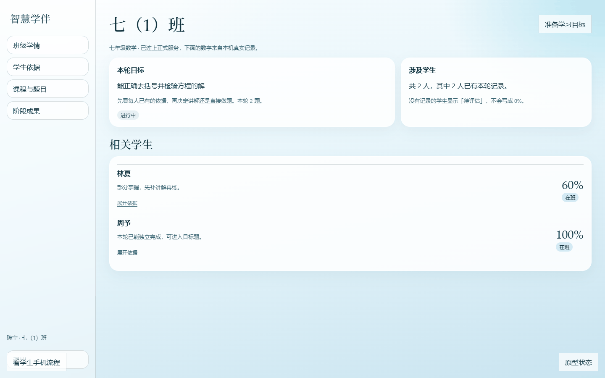
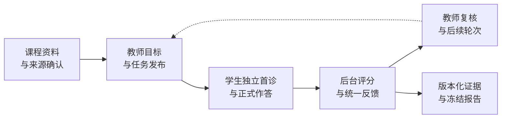

<div align="center">


<br>

# 智慧学伴 · AXIS

**把课程要求、学习证据与下一步学习安排，连成一条可追溯的线。**

第二届北京市大学生“人工智能+”创新大赛 · 第 10 题<br>
智慧学伴学情诊断与个性化学习智能体构建 · 阿克西斯队

<br>

[](LICENSE)
[](server/requirements.txt)
[](server/app)
[](docs/decisions-backend-platform.md)
[](docs/后端重构统一测试结果.md)
[](#技术构成)

[看效果](#看效果) · [它做什么](#它做什么) · [技术构成](#技术构成) · [验证记录](#验证记录) · [快速开始](#快速开始) · [许可与来源](#许可与来源)

</div>

---

> **当前阶段：正式认证、师生工作区与学生学伴 SSE／只读恢复已接通；正式赛事成果仍在制作。**
>
> `/prototype/` 对接 `/api/v1`，探测 `/health` 后明确标注真实平台或虚构原型模式。
> 2026-11-15 冻结版 `aede83a` 的学伴本机假网关 smoke 已通过8阶段、88次真实回环 HTTP 请求（24.469秒），Node联合回归144/144通过（572.848毫秒），完整Python回归417/417通过（137.333秒）；这些是本轮学生切换 Sol 之前的证据。
> 浏览器已确认会话与消息分页、发送追问后刷新、窄屏输入区、带题引导、行内命名、归档恢复、返回作答及停服后发送失败时的草稿保留；当前学生 Sol／价格／预算真实联调未执行，评分和摘要 Terra 仍未验收，见[验证记录](#验证记录)。

## 全流程演示

> **演示专用分支 `demo/recording-only-do-not-merge`，禁止合入正常代码。** 正常开发请切回 `docs/competition-production-direction`；隔离范围与限制见 [分支说明](DEMO_ONLY_DO_NOT_MERGE.md)。

双击 [`start_recording_demo.bat`](start_recording_demo.bat)，打开 <http://127.0.0.1:8010/prototype/>。通过顶部“演示工具”切换教师与两名学生，完成首诊、四题练习、逐步辅导、交卷、短评回复与报告下载。详细步骤及输入参考见[全流程演示操作指南](docs/全流程演示操作指南.md)。

每次启动使用独立新目录，保留旧数据；默认不调用外部模型。账号会话、保存、提交、客观评分及报告使用真实业务逻辑，辅导与预置简答规则评分明确标注模拟。此版本不包含录屏功能，由操作者自行录制。

## 看效果

<table>
<tr>
<td width="50%"><br><sub><b>教师工作台</b> · 本轮目标、相关学生、得分比例与展开依据</sub></td>
<td width="50%"><br><sub><b>学生端</b> · 教师发布的任务、截止时间、已评分成绩</sub></td>
</tr>
</table>

入口是一块流体玻璃装置：滚动推进装配、可拖动改变视角，随后露出右侧的档案板式登录区。
没有 WebGL 时自动退回静态版本，移动端切换为常规流式排版。

## 它做什么

智慧学伴面向教师与学生两端：教师依据课程资料和学习表现确定跟进目标，学生完成诊断、练习与提交，
结果再回到教师的复核与下一轮安排。**重点不是给一个分数，而是让每个判断都指得回它的依据。**



| 能力 | 实现与验证范围 |
| :--- | :--- |
| **账号与授权** | Cookie 登录、教师申请审核、学生建号激活与密码重置；课程资料与班级学情分别授权 |
| **资料与题目** | 私有原件保存、来源锚点、许可与可见范围确认；题目版本冻结 |
| **学习流程** | 幂等发布、独立首诊、编辑租约（同一任务一端一写）、草稿与正式提交分离、重复请求检查 |
| **学生学伴** | 会话创建／命名／归档恢复、作答页“问学伴”、后台回答与持久 SSE；每次连接／重连先接收当前政策下的权威快照，断线／刷新用 GET 只读恢复同一回答。暂停时可刷新、取消，费用与对账完成后才可明确确认恢复原作业。活跃任务仍为固定 `safe_guidance` |
| **评分与复核** | 后台客观评分、成绩与答案统一开放、异议转教师复核、追加更正；保留原答原分与修订历史 |
| **报告与导出** | 班级／个人／目标／题库四类范围；同一冻结快照导出 HTML、PDF、XLSX、JSON 与多表 CSV ZIP |
| **持久化与恢复** | 六库独立存储；附件、schema 与 SHA256 校验，隔离恢复后重启复验 |

**记录不足时不写 0 分。** 证据不够就保留“不足以判断／待评估”，缺少记录不视为答错。

### 三项赛题任务

| 赛题任务 | 当前实现基础 | 正式成果待补齐 |
| :--- | :--- | :--- |
| 学习内容与要求梳理 | 资料上传、来源定位、许可与可见块确认；要求与知识点关联存储 | 指定资料的内容、要求、必要联系与出处，形成可核对的梳理结果 |
| 学生学习情况分析 | 版本化作答与评分、首答／重做／求助记录、证据汇总、四类冻结报告 | 正式数据字段映射、统计复算、三名代表学生与两班同口径比较 |
| 个性化学习建议 | 教师目标与轮次发布、独立首诊、有限轮数持续计划、异议与教师更正 | 基于正式案例的具体材料、理由、顺序、分步提示与观察条件 |

## 技术构成

<table>
<tr><td width="18%"><b>后端</b></td><td>Python · FastAPI · SQLite WAL · 应用内后台 worker（队列、评分、报告）</td></tr>
<tr><td><b>持久层</b></td><td>platform / learning / jobs / content / reports / companion 六库，schema 内联迁移</td></tr>
<tr><td><b>并发契约</b></td><td>编辑租约与 fence token、幂等键、<code>expected_version</code> 与 <code>expected_source_revision</code> 乐观并发</td></tr>
<tr><td><b>前端</b></td><td>原生 ES 模块与手写 WebGL，<b>无框架、无构建步骤、无 CDN</b>；资源全部本地提供</td></tr>
<tr><td><b>认证</b></td><td>Argon2 口令散列 · HttpOnly Cookie 会话 · 一次性激活码／重置码 · 同源 Origin 校验</td></tr>
<tr><td><b>模型入口</b></td><td>独立 ModelGateway；teacher/student/grading/summary 四显式通道依次使用 Sol/Sol/Terra/Terra，全部 high；评分／摘要不回落 student。旧 LLMClient 单独保留，真实线路与教学质量待验</td></tr>
</table>

## 验证记录

测试数、HTTP 请求数和教学效果分别记录。下列417／144／88等结果保留为 `aede83a` 当时证据，不代表本轮学生 Sol 路由测试；后续结果见[模型接入约定](docs/模型分工与接入约定.md#验证状态)。

| 日期／验证层次 | 结果 | 说明 |
| :--- | :--- | :--- |
| 2026-11-15 `aede83a` 学伴 HTTP smoke | **8阶段通过，88次真实回环 HTTP 请求，24.469秒** | 真实应用、认证、数据库、worker、SSE与恢复；注入 `FakeGateway`，无真实上游，证据 `.scratch/companion-live-final-20261115-02/evidence.json`；关闭退出码0、`reaped: true`，临时数据库和凭据均已清理 |
| 2026-11-15 `aede83a` Node联合回归 | **144/144通过，0失败，572.848毫秒** | 学生72、传输34、教师38；使用下列四文件联合命令，含同游标队列状态通知与暂停／取消／确认恢复控件的自动化验证 |
| 2026-11-15 冻结版本完整Python回归 | **417/417通过，137.333秒，退出码0** | 完整回归入口 `server/tests/run_tests.py`；覆盖取消终态 `cancelled`、费用／对账保留及服务端确认恢复门禁。恢复门禁 worker＋queue 专项51/51通过，15.026秒 |
| 本轮学伴浏览器主流程 | **所列场景已通过** | 官方浏览器已确认103会话分页、110条历史消息分页、新建发送与追问后刷新同会话；390×844输入区位于底栏上方约11px，带题可编辑草稿及固定 `safe_guidance`、可访问行内命名（替换 `prompt`）、归档恢复通过；返回作答在390×844与1366×900均保留B选中及1/1进度，桌面三栏正常；桌面中文输入、Tab聚焦发送／Enter发出后两轮安全引导终态及输入框清空通过 |
| 本轮浏览器服务停止场景 | **新发送失败提示、草稿保留及重试入口已确认** | 停服后显示“连不上服务，请确认后端已启动”，保留中文草稿，提示发送结果未确认并提供重试原请求入口；未重启验证恢复，也不等于生成过程中断线重连的 GUI 测试 |
| 当前学生 Sol／价格／预算真实联调 | **未执行** | 本机 `.env` 未启用模型配置，当前进程环境未注入对应凭据；单价、币种及总调用额度未确认，评分和摘要 Terra 仍未验收，不能据夹具推断真实线路、账单或模型质量 |
| 2026-11-12 历史完整后端回归 | **345项通过**，0失败、0errors | 107.6秒；含元数据、外部关系、恶意XML拒绝回归 |
| 2026-11-12 历史正式服务 HTTP | **27阶段通过，399次请求** | 资料、评分、报告、60.7秒持续计划及六库恢复后重启；合成客观题、无模型调用，请求数含轮询 |
| 2026-11-13 历史师生前端连通 | **学生端、教师端、无后端降级通过** | 真实登录、任务及客观评卷结果；不代表本轮新学伴浏览器验收 |

2026-11-13 历史连通实测中，学生看到“教师发布 · 2题”及首次成绩 **3 / 5**；
教师工作台显示“七（1）班”、2名学生、得分比例 **60% / 100%**，依据来自同一轮真实保存的合成作答。
这些数字来自临时演示世界，**不是真实学生数据**。2026-11-10 Sol/high HTTP200仅为更早的最小连接记录。

学伴 SSE 每次获准连接／重连的第一帧都是按当前授权和答案政策投影的权威 `snapshot`；文本、代次和事件游标在同一读取事务中取得，客户端替换旧前缀后再接收后续片段。即使事件游标不变，队列状态、取消请求、待对账及待结算标记变化仍可通过快照通知。`reconciling`／`awaiting_confirmation` 显示暂停原因和“刷新状态”“取消本次回答”；费用未结清或调用结果仍待对账时，前后端均阻止恢复；允许时按钮明确为“确认恢复（可能产生费用）”，只恢复原作业／回答，不另发消息。取消回答的终态是 `cancelled`，已发生或待对账费用保留，费用未知时队列仍可保留 `reconciling`；取消不等于免除费用。这些新增控件仅有自动化验证，未追加 GUI 验收。

本轮返回作答会重新读取服务端权威任务并获取编辑租约；未修改的本地缓存不再遮蔽服务端草稿，已有自动回归和上述390×844／1366×900 GUI 复验，前轮另有1440×900桌面证据。`node --check` 与 `git diff --check` 此前已通过。当前浏览器运行时不支持减少动态、真实手机软键盘／IME组合输入与控制台监听，未做实际移动设备测试；窄屏和中文文本输入通过不等于实机或输入法组合验证。

旧 GUI 夹具 `.scratch/companion-live-browser-20261115-01` 被编排中断；确认进程与监听已不存在后，仅手动清理其隔离凭据与运行目录，元数据记录 `stopped_after_orchestrator_interruption`，不能记为正常关闭。新夹具 `.scratch/companion-live-browser-final-20261115-01` 已正常停止，`evidence.json` 记录 `status: stopped`、退出码0、`reaped: true` 和临时数据已删除，`service-info.json` 确认凭据已删除；本轮补验报告为该目录 `gui-report.md`，附 `screenshots/` 八张截图。分页、命名及归档恢复等沿用前轮已确认结果，未在补验重复执行。serve 的 `http_requests: 0` 不统计浏览器请求，不能充当独立 HTTP smoke 或 GUI 通过计数。

GUI 报告中的 Python411/411（127.234秒）、Node139/139（577.147毫秒）和旧冻结 smoke 91次／21.594秒是当时的历史记录，不是本轮最终计数；此前专项73/73（61.240秒）及独立 serve 生命周期正常启停也单列为旧证据。`aede83a` 的自动化状态以本节为准；GUI 报告保留当时计数，并已补充该冻结版自动化结果及后续控件未做 GUI 复验的说明。

历史平台验证的完整命令、失败修正记录与当时未覆盖路径见[验证结果](docs/后端重构统一测试结果.md)；
当前模型和费用边界见[模型接入约定](docs/模型分工与接入约定.md)。

## 快速开始

本地以 **Windows PowerShell、Python 3.11+** 为例，最近验证环境为 Python 3.12。
所有命令从仓库根目录开始，启动脚本只监听本机回环地址。

<details open>
<summary><b>① 安装依赖</b></summary>

```powershell
python -m venv server/.venv
.\server\.venv\Scripts\python.exe -m pip install -r server/requirements.txt
```
</details>

<details open>
<summary><b>② 初始化正式实例</b></summary>

同一个窗口内设置独立数据目录。相对 `DATA_DIR` 基于 `server/` 解析，下面数据保存于 `server/data/platform/`。

```powershell
$env:SKIP_ENV_FILE = "1"
$env:APP_ENV = "development"
$env:STUDY_DEMO_ENABLED = "false"
$env:STUDY_WORKER_ENABLED = "true"
$env:DATA_DIR = "./data/platform"
$env:COOKIE_SECURE = "false"
$env:STUDY_COMPANION_PORT = "8000"

Push-Location server
.\.venv\Scripts\python.exe -m app.init_admin --username your-admin --display-name 管理员
Pop-Location
```

密码由终端隐藏输入两次，要求 12–128 个字符。**没有默认管理员，也没有默认密码。**
初始化只在全新实例首次执行，已有管理员时会拒绝重复创建。
</details>

<details open>
<summary><b>③ 启动并检查</b></summary>

```powershell
.\start_study_companion.bat
```

| 入口 | 说明 |
| :--- | :--- |
| [服务状态](http://127.0.0.1:8000/) | 正式模式返回 JSON 与 `/api/v1` 入口提示 |
| [师生工作区](http://127.0.0.1:8000/prototype/) | 玻璃开场、真实登录、教师工作台、学生任务与学伴；自动探测后端并标注模式 |
| [健康检查](http://127.0.0.1:8000/health) | 返回 `mode: platform` 与 worker 状态 |

正式写请求需要同源 `Origin`，认证走 Cookie。关闭终端前按 `Ctrl+C` 停止服务。
</details>

<details>
<summary><b>④ 启动无上游的学伴 GUI 夹具</b></summary>

```powershell
.\server\.venv\Scripts\python.exe -I -B -X utf8 server/tests/verify_companion_live.py --serve --stream-seconds 8 --output-dir .scratch/companion-gui-NEW
```

输出必须是 `.scratch/` 下不存在且被 Git 忽略的新目录。读取该目录 `service-info.json` 的实际 origin，
访问其 `/prototype/`；`free/guided/diagnostic` 本机生成账号分别覆盖自由对话、任务固定引导和独立首诊，
凭据位置也由元数据提供，不输出或提交口令。

夹具使用真实应用／认证／worker，启动前注入确定性 `FakeGateway`，隔离 `.env` 和模型／MaxKB 配置，
**不访问真实上游**。正常停止后清理临时六库与本地凭据；按 Ctrl+C 或元数据中的停止文件结束。
默认 smoke 可另行执行，不带 `--serve`：

```powershell
.\server\.venv\Scripts\python.exe -I -B -X utf8 server/tests/verify_companion_live.py
```
</details>

<details>
<summary><b>⑤ 复现完整回归</b></summary>

激活项目虚拟环境后运行；根目录没有 `package.json`，Node 测试直接使用内置运行器：

```powershell
.\server\.venv\Scripts\Activate.ps1
python -I -B -X utf8 server/tests/run_tests.py
node --test server/tests/frontend-regression.cjs server/tests/companion-api-regression.cjs server/tests/teacher-library-regression.cjs server/tests/teacher-planning-regression.cjs
.\server\.venv\Scripts\python.exe -I -B -X utf8 server/tests/run_platform_flow.py
```

真实 HTTP 脚本自行选择本机端口，使用新临时数据库，结束后清理并输出脱敏 `evidence.json` 位置，
显式禁用模型与 MaxKB 上游。上述Node联合命令已通过144/144（学生72、传输34、教师38；0失败，572.848毫秒）；冻结版本完整Python回归417/417通过（137.333秒，退出码0），恢复门禁worker＋queue专项51/51通过（15.026秒）。
</details>

## 当前边界

| 待完成 | 对使用的影响 |
| :--- | :--- |
| 真实模型、MaxKB 与供应商账单 | `ModelGateway` 使用教师／学生Sol/high、评分／summary Terra/high；当前学生Sol真实联调及评分／摘要Terra验收均未完成；本机 `.env` 未启用模型配置，当前进程环境未注入对应凭据，单价、币种和总额度未确认，本轮未运行真实付费调用 |
| 学伴 SSE 与恢复验收 | 权威首帧快照和同一回答的 GET 只读恢复已有本机假网关 smoke／回归证据；新增暂停／取消／明确付费确认恢复控件仅自动化验证。浏览器已验证上述主流程和停服后新发送失败，未测这些新控件、重启恢复或生成中断线重连；真实供应商流式、减少动态、真实软键盘／IME组合及移动实机体验仍缺证据 |
| R29 与完整阶段 E | 活跃任务仍固定 `safe_guidance`，全局和任务门禁同时生效；逐步解题提示、课程检索及记忆增强未完成 |
| 正式赛事数据与成果 | 三项任务结果、三名代表学生、两班比较仍需基于获准资料完成 |
| 语音与扫描资料 | ASR 当前明确返回 503；扫描资料需人工核对 |
| 真实教学效果与规则校准 | 无提分率或长期效果结论；默认掌握度参数未经实证校准 |

付费调用须有版本化、明确币种的每百万token整数价格与适用额度；缺价格／预算或币种不匹配时阻断。
任务范围由服务端冻结，自由聊天使用个人全局日额及 `project/platform`，未知usage保留待对账；
`site-credit` 不保证法币兑换或供应商现金收费上限。凭据经环境变量／密钥服务注入并由 `api_key_env` 引用，
本机 `.env` 只保存非敏感配置，凭据不提交。上述 GUI 结果仅覆盖本机假网关场景及所列视口，不代表真实模型、完整阶段 E 或全部设备体验验收。

安全检查的剩余告警与覆盖限制详见验证记录。**本项目不宣称已完成全面安全审计。**

## 许可与来源

> [!IMPORTANT]
> **本项目采用 [PolyForm Noncommercial License 1.0.0](LICENSE) 授权——仅限非商业用途。**
> 商业使用需另行取得授权。分发时须一并提供本协议或其链接，以及 `Required Notice` 原文。

```text
Required Notice: Copyright (c) 2026 KROZ-coding (https://github.com/KROZ-coding/audit-companion)
```

| 项目 | 内容 |
| :--- | :--- |
| **许可协议** | PolyForm Noncommercial 1.0.0（非商业） |
| **协议全文** | [LICENSE](LICENSE) ／ [polyformproject.org](https://polyformproject.org/licenses/noncommercial/1.0.0) |
| **上游来源** | [`KROZ-coding/audit-companion`](https://github.com/KROZ-coding/audit-companion) |
| **上游提交** | `d01ab02d287641e5c62b731a7941b9a5c4e07b29` |
| **改动说明** | [THIRD_PARTY_NOTICES.md](THIRD_PARTY_NOTICES.md) · [本地部署与承接说明](docs/本地部署与承接说明.md) |

**允许**：个人学习、研究实验、教学与教研、非营利组织与公共机构使用、修改与再分发。

**需要另行授权**：任何商业目的的使用。

### 数据边界

正式赛题资料、个人信息、模型密钥、数据库、上传原件与生成产物**不进入代码仓库**。
使用赛事及公开资料前应登记来源、用途、引用位置与许可；第三方模型外发与留存按授权范围执行，
不引入真实学生个人信息。

## 文档导航

| 文档 | 用途 |
| :--- | :--- |
| [赛题要求与数据边界](docs/赛题要求与数据边界.md) | 核心任务、提交规格、规则依据与待确认事项 |
| [产品与前后端技术总方案](docs/智慧学伴产品与前后端技术总方案.md) | 产品目标、教学流程、前后端设计与首版范围 |
| [需求覆盖与多轮复核清单](docs/需求覆盖与复核清单.md) | 需求、设计覆盖与待验证条件 |
| [正式后端接入说明](docs/decisions-backend-platform.md) | 正式 API、六库布局、模型预算与运行边界 |
| [后端修复与实际流程验证](docs/后端重构统一测试结果.md) | 实测结果、复现命令与剩余缺口 |
| [制作方向与历史故事板](docs/制作方向/README.md) | 三任务证据、代表案例、班级比较与展示组织 |
| [模型分工与接入约定](docs/模型分工与接入约定.md) | 师生模型分工、参数与接入规则 |
| [前端参考与设计调研](docs/前端参考与设计技能调研.md) | 界面与设计依据 |
| [本地部署与承接说明](docs/本地部署与承接说明.md) | 正式启动、学伴 GUI 夹具、代码来源与旧样例边界 |

<details>
<summary><b>仓库结构</b></summary>

| 路径 | 用途 |
| :--- | :--- |
| `server/app/` | 正式 FastAPI、六库仓储、学习流程、后台队列与报告 |
| `server/tests/` | 隔离回归、真实 HTTP 流程、演示世界种子与连通验证 |
| `web/prototype/` | 可点击原型：流体玻璃入口、教师工作台、学生手机端 |
| `web/` · `demo/` | 旧样例网页与原始静态原型，保留供对照 |
| `docs/` | 赛题核对、产品设计、制作方向与验证记录 |
| `start_study_companion.bat` | Windows 本地启动入口 |

</details>

---

<div align="center">
<sub>

**阿克西斯队** · 第二届北京市大学生“人工智能+”创新大赛 · 第 10 题

代码以 [PolyForm Noncommercial 1.0.0](LICENSE) 授权 · 商业使用需另行授权

</sub>
</div>
