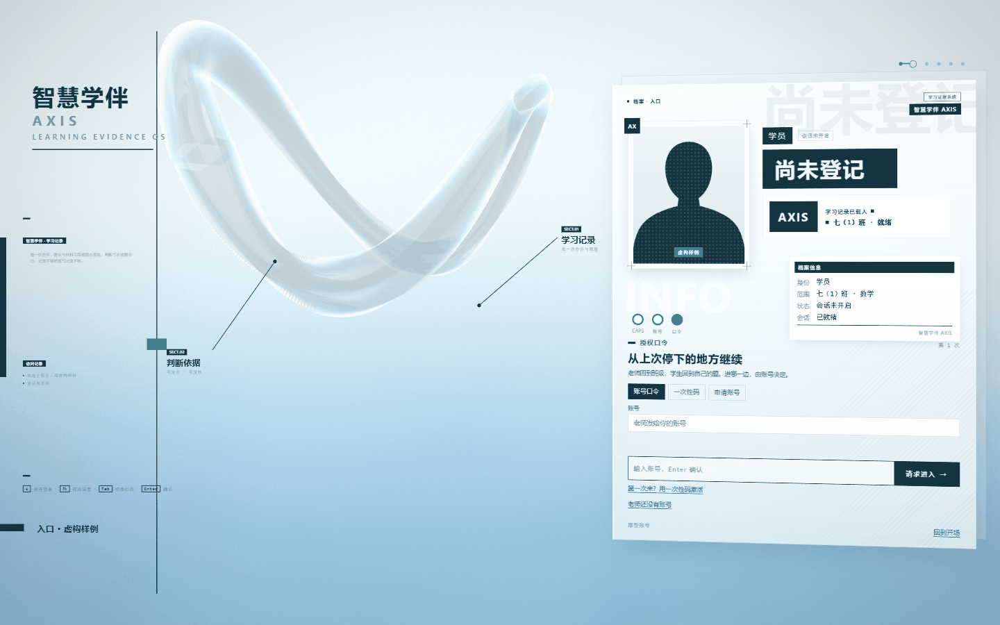
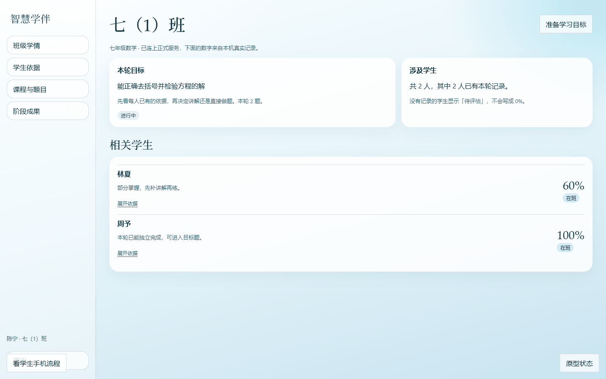
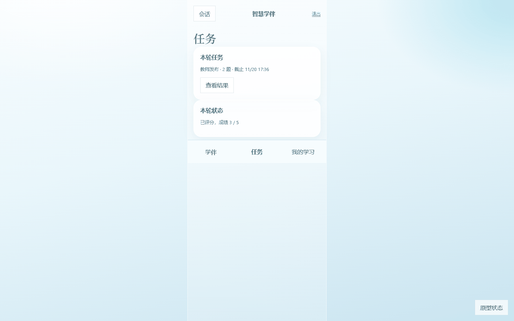
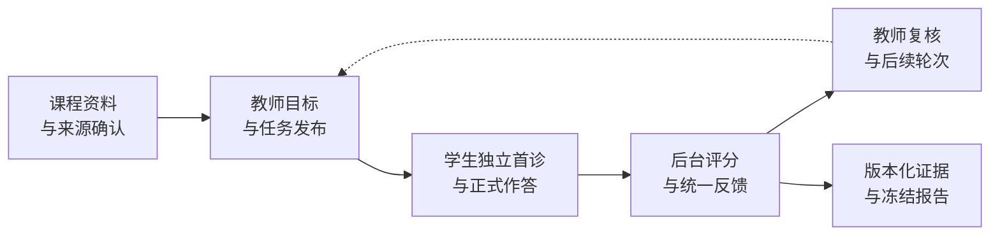

<div align="center">



<br>

# 智慧学伴 · AXIS

**把课程要求、学习证据与下一步学习安排，连成一条可追溯的线。**

第二届北京市大学生“人工智能+”创新大赛 · 第 10 题<br>
智慧学伴学情诊断与个性化学习智能体构建 · 阿克西斯队

<br>

[](LICENSE)
[](server/requirements.txt)
[](server/app)
[](docs/decisions-backend-platform.md)
[](docs/后端重构统一测试结果.md)
[](#技术构成)

[看效果](#看效果) · [它做什么](#它做什么) · [技术构成](#技术构成) · [验证记录](#验证记录) · [快速开始](#快速开始) · [许可与来源](#许可与来源)

</div>

---

> **当前阶段：正式后端与师生前端已在本地连通并验证；正式赛事成果仍在制作。**
>
> `/api/v1` 正式后端可用。原型会先探测一次 `/health`，再决定走真实数据还是退回虚构样例，
> 两种模式在界面上都有明确标注。真实模型、赛事数据适配与教学效果尚未完成验收。
> 最近一次连通验证：**2026-11-13**，见[验证记录](#验证记录)。

## 看效果

<table>
<tr>
<td width="50%"><br><sub><b>教师工作台</b> · 本轮目标、相关学生、得分比例与展开依据</sub></td>
<td width="50%"><br><sub><b>学生端</b> · 教师发布的任务、截止时间、已评分成绩</sub></td>
</tr>
</table>

入口是一块流体玻璃装置：滚动推进装配、可拖动改变视角，随后露出右侧的档案板式登录区。
没有 WebGL 时自动退回静态版本，移动端切换为常规流式排版。

## 它做什么

智慧学伴面向教师与学生两端：教师依据课程资料和学习表现确定跟进目标，学生完成诊断、练习与提交，
结果再回到教师的复核与下一轮安排。**重点不是给一个分数，而是让每个判断都指得回它的依据。**



| 能力 | 实现与验证范围 |
| :--- | :--- |
| **账号与授权** | Cookie 登录、教师申请审核、学生建号激活与密码重置；课程资料与班级学情分别授权 |
| **资料与题目** | 私有原件保存、来源锚点、许可与可见范围确认；题目版本冻结 |
| **学习流程** | 幂等发布、独立首诊、编辑租约（同一任务一端一写）、草稿与正式提交分离、重复请求检查 |
| **评分与复核** | 后台客观评分、成绩与答案统一开放、异议转教师复核、追加更正；保留原答原分与修订历史 |
| **报告与导出** | 班级／个人／目标／题库四类范围；同一冻结快照导出 HTML、PDF、XLSX、JSON 与多表 CSV ZIP |
| **持久化与恢复** | 六库独立存储；附件、schema 与 SHA256 校验，隔离恢复后重启复验 |

**记录不足时不写 0 分。** 证据不够就保留“不足以判断／待评估”，缺少记录不视为答错。

### 三项赛题任务

| 赛题任务 | 当前实现基础 | 正式成果待补齐 |
| :--- | :--- | :--- |
| 学习内容与要求梳理 | 资料上传、来源定位、许可与可见块确认；要求与知识点关联存储 | 指定资料的内容、要求、必要联系与出处，形成可核对的梳理结果 |
| 学生学习情况分析 | 版本化作答与评分、首答／重做／求助记录、证据汇总、四类冻结报告 | 正式数据字段映射、统计复算、三名代表学生与两班同口径比较 |
| 个性化学习建议 | 教师目标与轮次发布、独立首诊、有限轮数持续计划、异议与教师更正 | 基于正式案例的具体材料、理由、顺序、分步提示与观察条件 |

## 技术构成

<table>
<tr><td width="18%"><b>后端</b></td><td>Python · FastAPI · SQLite WAL · 应用内后台 worker（队列、评分、报告）</td></tr>
<tr><td><b>持久层</b></td><td>platform / learning / jobs / content / reports / companion 六库，schema 内联迁移</td></tr>
<tr><td><b>并发契约</b></td><td>编辑租约与 fence token、幂等键、<code>expected_version</code> 与 <code>expected_source_revision</code> 乐观并发</td></tr>
<tr><td><b>前端</b></td><td>原生 ES 模块与手写 WebGL，<b>无框架、无构建步骤、无 CDN</b>；资源全部本地提供</td></tr>
<tr><td><b>认证</b></td><td>Argon2 口令散列 · HttpOnly Cookie 会话 · 一次性激活码／重置码 · 同源 Origin 校验</td></tr>
</table>

## 验证记录

测试数、HTTP 请求数和教学效果是三件不同的事，下面分开记。

| 验证层次 | 结果 | 说明 |
| :--- | :--- | :--- |
| 完整后端回归 | **345 项通过**，0 失败 0 errors | 107.6 秒；含元数据序列化、外部关系、恶意 XML 拒绝回归 |
| 正式服务真实 HTTP | **27 阶段通过**，399 次请求 | 实际 uvicorn、Cookie、SQLite 与后台 worker；请求数含轮询 |
| 资料草稿更新 | 特殊字符与权限字段保留 | 越权请求与旧版本请求均被拒绝 |
| 持续计划与恢复 | 60.7 秒后自动发布下一轮 | 六库恢复后重启，4 个账号登录、4 个任务、成绩与历史报告读取通过 |
| **师生前端连通** | **学生端、教师端、无后端降级全部通过** | 2026-11-13；真实登录、真实任务、真实评卷结果渲染正确 |

最近一次连通验证的实测输出：学生登录后看到“教师发布 · 2 题”与首次成绩 **3 / 5**；
教师工作台显示“七（1）班”、2 名学生、得分比例 **60% / 100%**，展开依据显示
“本轮 2 条评分记录，来自 1 次作答，得分 3/5”。这些数字来自临时种出的演示世界，
**不是真实学生数据**。

HTTP 验证预置五道合成已审核客观题，未调用真实模型。完整命令、失败修正记录与未覆盖路径见
[验证结果](docs/后端重构统一测试结果.md)。

## 快速开始

本地以 **Windows PowerShell、Python 3.11+** 为例，最近验证环境为 Python 3.12。
所有命令从仓库根目录开始，启动脚本只监听本机回环地址。

<details open>
<summary><b>① 安装依赖</b></summary>

```powershell
python -m venv server/.venv
.\server\.venv\Scripts\python.exe -m pip install -r server/requirements.txt
```
</details>

<details open>
<summary><b>② 初始化正式实例</b></summary>

同一个窗口内设置独立数据目录。相对 `DATA_DIR` 基于 `server/` 解析，下面数据保存于 `server/data/platform/`。

```powershell
$env:SKIP_ENV_FILE = "1"
$env:APP_ENV = "development"
$env:STUDY_DEMO_ENABLED = "false"
$env:STUDY_WORKER_ENABLED = "true"
$env:DATA_DIR = "./data/platform"
$env:COOKIE_SECURE = "false"
$env:STUDY_COMPANION_PORT = "8000"

Push-Location server
.\.venv\Scripts\python.exe -m app.init_admin --username your-admin --display-name 管理员
Pop-Location
```

密码由终端隐藏输入两次，要求 12–128 个字符。**没有默认管理员，也没有默认密码。**
初始化只在全新实例首次执行，已有管理员时会拒绝重复创建。
</details>

<details open>
<summary><b>③ 启动并检查</b></summary>

```powershell
.\start_study_companion.bat
```

| 入口 | 说明 |
| :--- | :--- |
| [服务状态](http://127.0.0.1:8000/) | 正式模式返回 JSON 与 `/api/v1` 入口提示 |
| [可点击原型](http://127.0.0.1:8000/prototype/) | 玻璃开场、教师工作台、学生手机流程；自动探测后端 |
| [健康检查](http://127.0.0.1:8000/health) | 返回 `mode: platform` 与 worker 状态 |

正式写请求需要同源 `Origin`，认证走 Cookie。关闭终端前按 `Ctrl+C` 停止服务。
</details>

<details>
<summary><b>④ 自己造一个演示世界，验证前后端确实连通</b></summary>

```powershell
# 种演示世界 → 起服务 → 师生两轮浏览器验证 → 关服务 → 无后端降级验证
.\server\.venv\Scripts\python.exe -I -B -X utf8 server/tests/verify_prototype_live.py
```

需要 Node 与 `.scratch/proto-test` 里安装好的 `puppeteer-core`。演示世界的口令只写入
临时目录并在结束时清理，**不会进入仓库**。
</details>

<details>
<summary><b>⑤ 复现完整回归</b></summary>

```powershell
.\server\.venv\Scripts\python.exe -I -B server/tests/run_tests.py
.\server\.venv\Scripts\python.exe -I -B server/tests/run_platform_flow.py
```

真实 HTTP 脚本自行选择本机端口，用新临时数据库，结束后清理并输出脱敏 `evidence.json` 位置。
脚本显式禁用模型与 MaxKB 上游。
</details>

## 当前边界

| 待完成 | 对使用的影响 |
| :--- | :--- |
| 真实模型、MaxKB、SSE 与账单 | 已有适配与协议测试；真实线路、出题／审题／主观评分质量及成本未验收 |
| 正式赛事数据与成果 | 三项任务结果、三名代表学生、两班比较仍需基于获准资料完成 |
| 语音、扫描资料与开放式辅导 | ASR 当前明确返回 503；扫描资料需人工核对 |
| 真实教学效果与规则校准 | 无提分率或长期效果结论；默认掌握度参数未经实证校准 |

工作台与学生端的视觉尚未与入口统一，R90 键位动效与死代码清理仍在待办。

安全检查的剩余告警与覆盖限制详见验证记录。**本项目不宣称已完成全面安全审计。**

## 许可与来源

> [!IMPORTANT]
> **本项目采用 [PolyForm Noncommercial License 1.0.0](LICENSE) 授权——仅限非商业用途。**
> 商业使用需另行取得授权。分发时须一并提供本协议或其链接，以及 `Required Notice` 原文。

```text
Required Notice: Copyright (c) 2026 KROZ-coding (https://github.com/KROZ-coding/audit-companion)
```

| 项目 | 内容 |
| :--- | :--- |
| **许可协议** | PolyForm Noncommercial 1.0.0（非商业） |
| **协议全文** | [LICENSE](LICENSE) ／ [polyformproject.org](https://polyformproject.org/licenses/noncommercial/1.0.0) |
| **上游来源** | [`KROZ-coding/audit-companion`](https://github.com/KROZ-coding/audit-companion) |
| **上游提交** | `d01ab02d287641e5c62b731a7941b9a5c4e07b29` |
| **改动说明** | [THIRD_PARTY_NOTICES.md](THIRD_PARTY_NOTICES.md) · [本地部署与承接说明](docs/本地部署与承接说明.md) |

**允许**：个人学习、研究实验、教学与教研、非营利组织与公共机构使用、修改与再分发。

**需要另行授权**：任何商业目的的使用。

### 数据边界

正式赛题资料、个人信息、模型密钥、数据库、上传原件与生成产物**不进入代码仓库**。
使用赛事及公开资料前应登记来源、用途、引用位置与许可；第三方模型外发与留存按授权范围执行，
不引入真实学生个人信息。

## 文档导航

| 文档 | 用途 |
| :--- | :--- |
| [赛题要求与数据边界](docs/赛题要求与数据边界.md) | 核心任务、提交规格、规则依据与待确认事项 |
| [产品与前后端技术总方案](docs/智慧学伴产品与前后端技术总方案.md) | 产品目标、教学流程、前后端设计与首版范围 |
| [需求覆盖与多轮复核清单](docs/需求覆盖与复核清单.md) | 需求、设计覆盖与待验证条件 |
| [正式后端接入说明](docs/decisions-backend-platform.md) | 正式 API、六库布局、模型预算与运行边界 |
| [后端修复与实际流程验证](docs/后端重构统一测试结果.md) | 实测结果、复现命令与剩余缺口 |
| [制作方向与历史故事板](docs/制作方向/README.md) | 三任务证据、代表案例、班级比较与展示组织 |
| [模型分工与接入约定](docs/模型分工与接入约定.md) | 师生模型分工、参数与接入规则 |
| [前端参考与设计调研](docs/前端参考与设计技能调研.md) | 界面与设计依据 |
| [本地部署与承接说明](docs/本地部署与承接说明.md) | 代码来源与历史基线 |

<details>
<summary><b>仓库结构</b></summary>

| 路径 | 用途 |
| :--- | :--- |
| `server/app/` | 正式 FastAPI、六库仓储、学习流程、后台队列与报告 |
| `server/tests/` | 隔离回归、真实 HTTP 流程、演示世界种子与连通验证 |
| `web/prototype/` | 可点击原型：流体玻璃入口、教师工作台、学生手机端 |
| `web/` · `demo/` | 旧样例网页与原始静态原型，保留供对照 |
| `docs/` | 赛题核对、产品设计、制作方向与验证记录 |
| `start_study_companion.bat` | Windows 本地启动入口 |

</details>

---

<div align="center">
<sub>

**阿克西斯队** · 第二届北京市大学生“人工智能+”创新大赛 · 第 10 题

代码以 [PolyForm Noncommercial 1.0.0](LICENSE) 授权 · 商业使用需另行授权

</sub>
</div>
