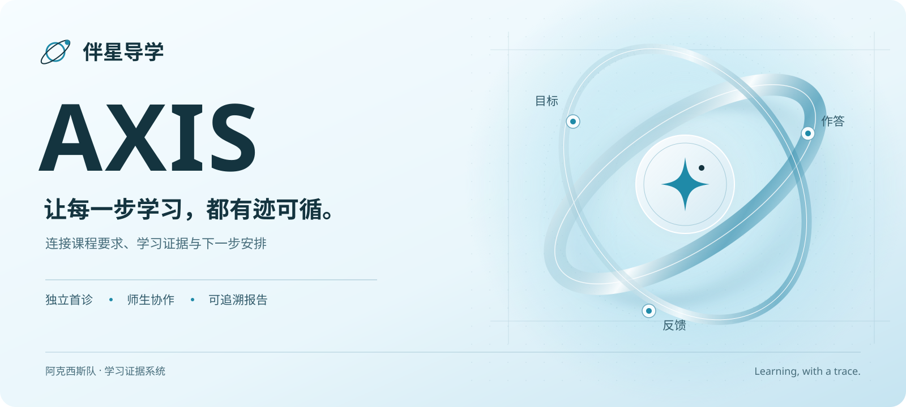
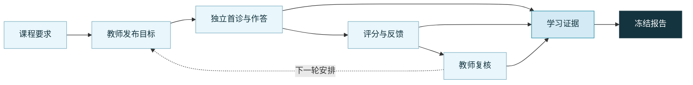
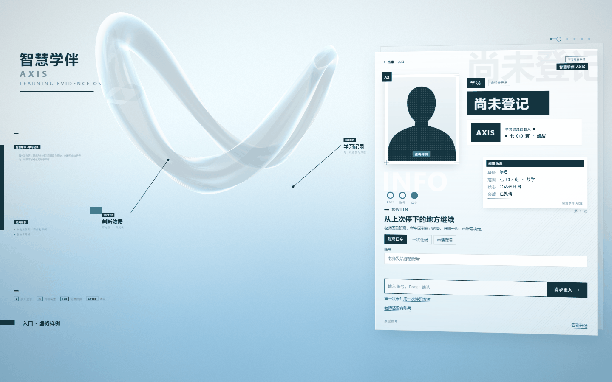
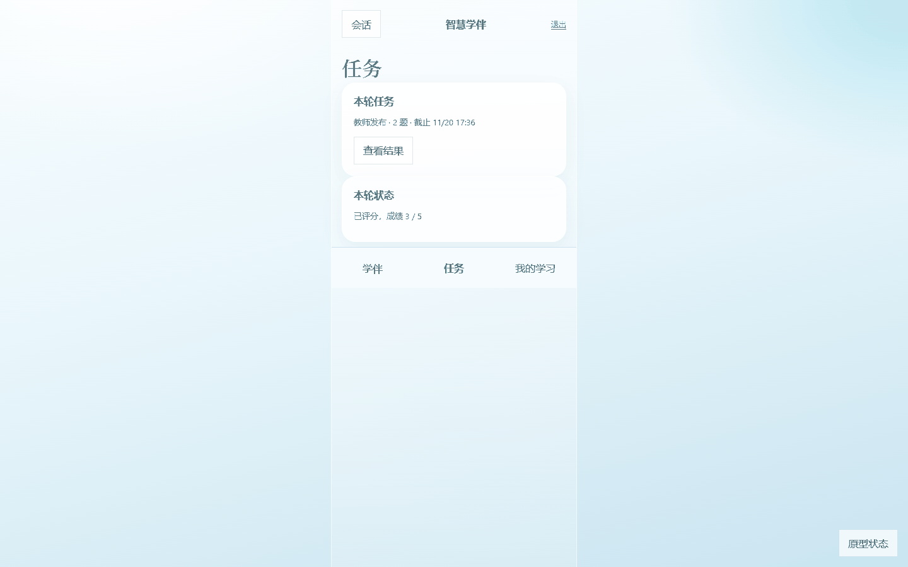

<div align="center">



# 伴星导学 · AXIS

**让每一步学习，都有迹可循。**

面向教师与学生的学习证据系统，将课程要求、独立作答、学伴引导和教师复核连成完整学习流程。

[](LICENSE)
[](https://github.com/KROZ-coding/axis-study-companion/blob/main/server/requirements.txt)
[](#技术构成)
[](#技术构成)

[**体验演示**](#快速体验) · [**看界面**](#界面一览) · [**了解能力**](#让学习记录真正连起来) · [**部署与文档**](#文档导航) · [**验证与边界**](#进展与验证)

<sub>阿克西斯队 · 第二届北京市大学生“人工智能+”创新大赛 · 第 10 题</sub>

</div>

<br>

> [!NOTE]
> **当前为开发中的比赛项目。** 正式认证、师生工作区与学伴会话已接通；第二、第三阶段的历史作答、人工批改、师生讨论与冻结报告已接入正式工作区，自动回归、独立 HTTP、所列浏览器主流程和 145 页导出视觉检查已完成。第四阶段的首诊“暂时不会”、草稿保存、AI 学情总结、下一轮发布与两级受限提示已接入正式工作区，隔离回归与独立 HTTP 已完成。真实模型质量、供应商账单、完整设备验收与正式赛事成果仍待验收。
>
> 正式代码与当前任务统一在 [`main`](https://github.com/KROZ-coding/axis-study-companion/tree/main) 更新。根目录用于正式开发，`demo/recording-demo/` 保留独立演示。

## 让学习记录真正连起来

教师看得到判断的依据，学生接得住下一步任务。AXIS 将每一次作答、求助与修订保留下来，让后续安排能够回到具体证据。

| 对谁有用 | 可以做什么 |
| :--- | :--- |
| **教师 · 从目标到复核** | 管理题库、发布目标与轮次，复核评分并保留修订历史；从冻结报告生成有依据的学情总结，编辑、预览并确认原目标的下一轮练习。 |
| **学生 · 从尝试到反馈** | 独立首诊可标记“暂时不会”；正式练习自动保存草稿，已有尝试后可请求两级受限提示，再交卷、查看历史反馈、回复教师并提出评分异议。 |
| **协作 · 从记录到报告** | 会话可命名、归档和恢复；学习证据形成班级、个人、目标、题库四类报告，同一快照支持五种导出格式。 |



**记录不足时保留“待评估”。** 缺少证据不记成 0 分；独立作答、获得提示和重做分别记录。

## 界面一览

冰蓝流体玻璃入口，配合档案板式登录与师生工作区。入口支持滚动、拖动交互；缺少 WebGL 时提供静态降级，窄屏采用流式排版。



<sub>早期入口视觉，保留当时的“智慧学伴”名称；当前品牌为“伴星导学 AXIS”。</sub>

<details>
<summary><strong>展开教师与学生工作区的早期截图</strong></summary>

**教师工作区：目标、班级进展与作答依据。**


**学生工作区：本轮任务与提交结果。**



以上为早期样例界面，人物与成绩均为虚构或合成数据，不代表真实教学效果；当前会话功能与验收范围见[验证记录](docs/验证记录与边界.md)。

</details>

## 快速体验

本地运行使用 **Windows PowerShell、Python 3.11+**，前端无需构建。首次获取当前开发版本：

```powershell
git clone --branch main https://github.com/KROZ-coding/axis-study-companion.git
cd axis-study-companion
python -m venv server/.venv
.\server\.venv\Scripts\python.exe -m pip install -r server/requirements.txt
```

已有这份开发工作区时，直接使用现有目录。正式代码在根目录，演示在独立文件夹，日常开发无需来回切换分支。

### 先看完整演示

```powershell
.\demo\recording-demo\start_recording_demo.bat
```

打开 **[本机演示工作区](http://127.0.0.1:8010/prototype/)**，按[全流程演示指南](https://github.com/KROZ-coding/axis-study-companion/blob/main/demo/recording-demo/docs/全流程演示操作指南.md)操作：

**教师发布 → 学生首诊 → 四类题型作答 → 分步提示 → 交卷反馈 → 教师短评 → 学生回复 → 报告下载**

作答、草稿、求助记录、师生讨论和报告真实保存。逐步辅导、默认聊天及预置简答评分采用**明确标注的本机模拟**；默认不读取 `.env`、不调用付费模型。每次启动创建新的演示运行目录，保留旧记录。录屏由操作者自行完成。

### 开始正式开发

根目录 `server/`、`web/` 是正式开发位置；`demo/recording-demo/` 保留独立演示副本。

按[本地部署说明](https://github.com/KROZ-coding/axis-study-companion/blob/main/docs/本地部署与承接说明.md)设置环境和数据目录，首次初始化管理员后启动：

```powershell
.\start_study_companion.bat
```

打开 [正式师生工作区](http://127.0.0.1:8000/prototype/)，通过 [健康检查](http://127.0.0.1:8000/health)确认模式与 worker 状态。**没有默认管理员账号或密码**；完整初始化命令也保留在[复现说明](docs/验证记录与边界.md#快速开始)中。

## 技术构成

| 层次 | 选择与作用 |
| :--- | :--- |
| **交互** | 原生 JavaScript ES modules + 手写 WebGL，资源本地提供，无前端构建步骤。 |
| **服务** | Python + FastAPI，统一 `/api/v1`，后台 worker 处理评分与学伴；报告由冻结证据同步生成。 |
| **持久化** | SQLite WAL；platform、learning、jobs、content、reports、companion 六库按职责保存。 |
| **一致性** | 编辑租约、幂等请求和版本校验；草稿与交卷分离，报告绑定冻结快照与修订号。 |
| **认证与授权** | Argon2 口令散列、HttpOnly Cookie、一次性激活／重置码、同源 Origin 与角色范围检查。 |
| **模型接入** | ModelGateway 分离教师、学生、评分、摘要通道；价格、预算、取消与费用对账单独管理。 |

**四类报告 × 五种格式：** 班级、个人、目标、题库；HTML、PDF、XLSX、JSON、多表 CSV ZIP。

接口与数据契约见[正式后端接入说明](https://github.com/KROZ-coding/axis-study-companion/blob/main/docs/decisions-backend-platform.md)，模型路由及费用规则见[模型接入约定](https://github.com/KROZ-coding/axis-study-companion/blob/main/docs/模型分工与接入约定.md)。

## 进展与验证

正式管理工作区已接通教师与课程审核、账号搜索、停用／恢复、口令重设，以及教师建班、学生建号发码和额度设置。第二、第三阶段已在正式工作区接通历史目标与提交选择、人工批改与更正、师生短评与回复、通知精确定位，以及四类冻结报告的修订切换、预览和五格式下载。第四阶段已在正式工作区接通首诊“暂时不会”与作答互斥、正式草稿自动保存与恢复、基于冻结报告的学情总结、教师确认的原目标下一轮发布，以及正式题两级受限提示。以下测试数字分别对应所列开发阶段与版本。

| 版本与日期 | 验证记录 | 解释 |
| :--- | :--- | :--- |
| 教学闭环阶段 · 2026-11-16—17 | **564 / 564** Python（394.702 秒）；十二文件 Node **406 / 406**（1860.9907 毫秒）；验收器收尾专项 **8 / 8**；最终独立 HTTP **8 个阶段、330 次请求**（48.078 秒） | 全量、专项与 HTTP 均通过，退出码 0。最终 HTTP 本机合成调用 12 次（提示 3、总结 9），真实供应商调用 0；临时六库与凭据已删除，worker 为 0。收尾另修复“提示已完成后再取消仍可读到正文”，由服务端读取投影统一拦截，取消后隐藏正文但保留已完成结果与费用事实。 |
| 批改、反馈与报告阶段 · 2026-11-16 | **472 / 472** Python（176.454 秒）；十文件 Node **351 / 351**（1455.3695 毫秒）；独立 HTTP **14 个必需阶段、319 次请求**（39.219 秒） | Python、Node 均退出码 0、失败 0，Node 取消／跳过均为 0；HTTP 状态 passed。四范围 × 五格式共 20 份导出，新更正后旧修订导出字节不变；网关 describe／complete 与外部连接尝试均为 0，独立 HTTP 临时六库和凭据已删除，worker 为 0。 |
| 管理与建班阶段 · 2026-11-16 | **439 / 439** Python、**235 / 235** Node 联合回归 | 浏览器已走通教师申请与审核、课程申请与审核、建班、学生建号、首次激活登录及班级日额保存；合成账号、临时数据库、无真实供应商调用。 |
| `fc2cd4c` · 2026-11-15 | **418 / 418** Python 回归；学伴 HTTP **8 阶段、90 次请求** | 隔离上游配置，使用 FakeGateway；验证真实应用、认证、数据库、worker、SSE 与恢复。 |
| `aede83a` · 2026-11-15 | **144 / 144** Node 联合回归 | 学生、传输、教师相关前端回归；是该冻结版本的记录。 |
| `77b1d86` · 2026-11-15 | 独立演示 **3 / 3** Python、**3 / 3** Node | 目录迁移后的流程、报告和权限专项；独立启动与静态资源来源核对通过。 |

第二、第三阶段 GUI 已走通关闭提交任务的人工评分、教师自由短评、学生通知精确定位与回复、教师重新登录读取回复，以及四类报告、预览、五格式下载事件和历史修订切换。学生重新登录及刷新后，目标名称、答案格式、教师短评与学生回复均正确保留；教师批改和学生反馈的桌面／窄屏可见区域、报告桌面可见区域截图检查通过。GUI 实例已正常停止，临时六库、凭据已删除，worker 为 0。

第四阶段学生 GUI 主链已走通：登录后进入正式任务，在正式题填写独特草稿并等待页面显示“服务器已确认保存”，刷新后自动恢复登录且草稿逐字一致；一级“知识提示”和二级“下一步方向”都以固定模板交付，状态显示“已确认交付”，返回作答后草稿仍在；通过“全部对话”重开记录，刷新后仍读到同一题目、同一级别和相同正文。1366×900 与 390×844 的学生作答／提示可见区域截图检查通过。GUI 实例已正常停止，临时六库、凭据已删除，worker 为 0；未做 GUI 故障注入、真实输入法与移动实机验收。

报告 renderer 专项 **44 / 44** 通过；PDF 普通行跨页、XLSX 重复标识与行高问题已修复。冻结导出的 **145 / 145 页**已实际视觉检查（PDF 30 页、Excel 原生打印 115 页）。独立视觉评审工具不可用，本轮由唯一替代检查路径完成逐页复核；报告窄屏截图因工具超时未通过验收。完整方法与未覆盖项见验证记录。

独立 HTTP 证据位于 `.scratch/review-reports-20261116-191119-9dbae7/evidence.json`。详细浏览器覆盖、复现命令和历史记录完整保存在[验证记录与边界](docs/验证记录与边界.md)。测试通过不等于模型教学质量或教学效果验收。

<details>
<summary><strong>当前边界与接下来的工作</strong></summary>

- **正式交付与后续：** 第二至第四阶段已在 `main` 接通；第四阶段的学情总结只基于冻结报告的目标级证据、由服务端模板生成，不定位具体薄弱知识点，不称自由 AI 诊断；受限提示为两级固定模板，不是开放式解题。
- **真实模型与费用验收：** 教师／学生 Sol、评分／摘要 Terra 的正式线路、内容质量和供应商账单仍需核验；缺价格或预算时阻断付费调用。
- **正式辅导能力：** 课程检索和记忆增强待完成。演示中的模拟提示不代表正式能力已交付。
- **浏览器与设备：** 学生反馈刷新恢复、第四阶段学生草稿自动保存与刷新恢复、两级提示及历史重读已验证；本轮报告窄屏截图、历史提交切换和更正／异议的完整 GUI 分支，以及断网等 GUI 故障注入尚未验收。学伴暂停／取消／确认恢复控件及取消后隐藏提示正文有自动化验证，未做浏览器故障注入；生成中断线重连、真实手机 IME／软键盘与移动实机验收仍未完成。
- **赛事成果：** 基于获准数据的三任务结果、三名代表学生与两班比较仍在制作；无提分率或长期教学效果结论。
- **语音与资料：** ASR 当前返回 503，扫描资料需人工核对；默认掌握度参数待实证校准。

本项目不宣称已完成全面安全审计。具体限制以[验证记录](docs/验证记录与边界.md#当前边界)为准。

</details>

## 文档导航

| 想了解什么 | 从这里开始 |
| :--- | :--- |
| 安装、初始化与本机运行 | [本地部署与承接说明](https://github.com/KROZ-coding/axis-study-companion/blob/main/docs/本地部署与承接说明.md) |
| 演示流程与真实／模拟边界 | [独立演示说明](https://github.com/KROZ-coding/axis-study-companion/blob/main/demo/recording-demo/README.md) · [操作指南](https://github.com/KROZ-coding/axis-study-companion/blob/main/demo/recording-demo/docs/全流程演示操作指南.md) |
| 赛题与产品方向 | [赛题要求与数据边界](https://github.com/KROZ-coding/axis-study-companion/blob/main/docs/赛题要求与数据边界.md) · [产品技术总方案](https://github.com/KROZ-coding/axis-study-companion/blob/main/docs/智慧学伴产品与前后端技术总方案.md) |
| 已做什么、还差什么 | [需求覆盖清单](https://github.com/KROZ-coding/axis-study-companion/blob/main/docs/需求覆盖与复核清单.md) · [验证记录与边界](docs/验证记录与边界.md) |
| 接口、存储与模型 | [后端接入说明](https://github.com/KROZ-coding/axis-study-companion/blob/main/docs/decisions-backend-platform.md) · [模型接入约定](https://github.com/KROZ-coding/axis-study-companion/blob/main/docs/模型分工与接入约定.md) |
| 成果组织与设计依据 | [制作方向](https://github.com/KROZ-coding/axis-study-companion/blob/main/docs/制作方向/README.md) · [前端设计调研](https://github.com/KROZ-coding/axis-study-companion/blob/main/docs/前端参考与设计技能调研.md) |

<details>
<summary><strong>目录结构与首页设计参考</strong></summary>

当前开发版本的目录：

```text
axis-study-companion/
├── server/                  正式 API、六库仓储、worker 与测试
├── web/prototype/           正式师生工作区与流体玻璃入口
├── demo/recording-demo/     独立的全流程演示副本
├── docs/                    产品设计、接入契约与验证记录
└── start_study_companion.bat
```

`web/` 与 `demo/` 中原有样例保留供对照；全流程演示使用 `demo/recording-demo/` 内的启动器。

首页的信息组织参考 [Dify](https://github.com/langgenius/dify)、[LobeHub](https://github.com/lobehub/lobehub) 和 [Open WebUI](https://github.com/open-webui/open-webui) 的品牌封面、产品画面、快速体验与文档导航。冰蓝轨道封面为本项目原创 SVG，没有使用上述项目的品牌素材。

</details>

## 许可与来源

> [!IMPORTANT]
> **本项目采用 [PolyForm Noncommercial License 1.0.0](LICENSE)，仅限许可规定的非商业用途。** 商业使用须另获许可方授权；分发时须提供许可条款或其链接，并保留 Required Notice。

```text
Required Notice: Copyright (c) 2026 KROZ-coding (https://github.com/KROZ-coding/audit-companion)
```

项目包含源自 [KROZ-coding/audit-companion](https://github.com/KROZ-coding/audit-companion) 的代码，上游提交为 `d01ab02d287641e5c62b731a7941b9a5c4e07b29`。完整条款与来源见 [LICENSE](LICENSE)、[THIRD_PARTY_NOTICES.md](THIRD_PARTY_NOTICES.md) 和[承接说明](https://github.com/KROZ-coding/axis-study-companion/blob/main/docs/本地部署与承接说明.md)。

正式赛题资料、个人信息、模型密钥、数据库、上传原件与生成产物不进入代码仓库。资料使用须登记来源、用途、引用位置与许可；第三方模型外发与留存遵守授权范围，不引入真实学生个人信息。

---

<div align="center">

**伴星导学 AXIS** · Learning, with a trace.

<sub>阿克西斯队 · 让每一步学习，都有迹可循。</sub>

</div>
