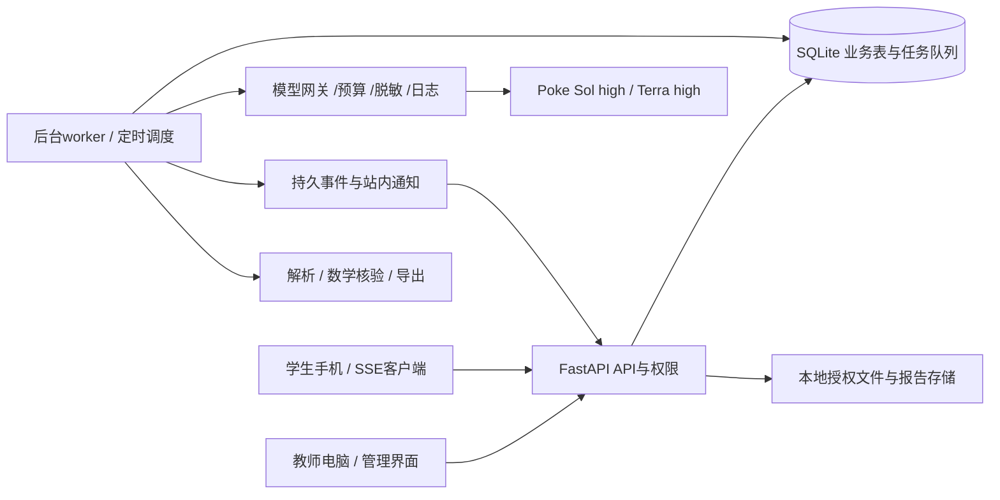

# 智慧学伴产品与前后端技术总方案

> 版本：v1.1（多轮复核修订稿）
>
> 整理日期：2026-11-11
>
> 依据：本轮及此前需求访谈中的用户明确选择、仓库现有实现、已整理的赛事要求。
>
> 状态：**制作依据与验收草案，不代表功能已经实现。**本次任务仅整理文档。技术选型、计算参数和建议默认值均单独标注，不能当作用户已确认的数值。

## 0. 阅读约定与文档优先级

本文使用四种标签：

- **[已确认]**：用户已明确选择的产品行为，实施时不得静默更改。
- **[设计建议]**：为使已确认需求可落地而提出的架构、接口、数据结构或默认策略；可在实现评审中调整，但需保持产品语义。
- **[现有]**：当前仓库已有能力，与计划能力分开描述。
- **[待验证]**：接口、资料许可、性能、参数或外部条件未完成验证，不得写成可用性或效果承诺。

发生冲突时，以用户后续明确要求优先，其次为本文中的已确认需求。本文统一更新后续制作方向；原《教学流程与前后端重构计划》保留为 2026-11-09 历史计划，`decisions-teaching-flow.md` 保留为上一轮后端实现说明。

相关文档：

- [需求覆盖与多轮复核清单](需求覆盖与复核清单.md)：逐项追踪覆盖、修订、未决条件与验收。
- [模型分工与接入约定](模型分工与接入约定.md)：准确型号、high 参数、配置模板和实际测试边界。
- [赛题要求与数据边界](赛题要求与数据边界.md)：团队对正式资料的整理，不替代官方最新规定。
- [上一轮后端接入说明](decisions-teaching-flow.md)、[本地部署与承接说明](本地部署与承接说明.md)。

保存本文件不构成对外部模型发送赛事原件、公开部署、采集真实学生信息或执行付费压力测试的授权。

## 1. 项目定位与交付范围

### 1.1 产品要做成什么样

**[已确认]** 做成具有真实师生账号、连续学习过程和可核对诊断的完整教学产品。比赛作品优先让评委看见两点：

1. 判断有课程和学习证据，能够解释为什么这样判断、为什么这样安排。
2. 教师目标、学生学习、提交、反馈与后续观察连接成实际可用的过程。

主场景为“单元诊断与针对性补学＋学生自主学习”。教师定目标，AI 在目标内提供个性化选题、讲解和提示；教师可以复核依据与最终教学判断。教学内容以赛事实际资料为准，当前虚构七年级数学样例仅用于开发演示。

### 1.2 完整目标与首版

| 交付层 | 范围 | 验收方式 |
| --- | --- | --- |
| P0：可点击核心原型 | 统一登录开场、教师工作台、右侧目标抽屉、手机学伴、独立任务/自主练习、结果页和关键异常状态 | 用户实际操作确认布局、玻璃风格、动效及流程；使用标注的虚构内容，不假装真实 AI |
| P1：首版真实学习主线 | 一门课程、多班级；真实账号与必要管理；已确认课程/基础题库；目标与提前备题；首诊、学习、保存、提交、AI 评分/复核、可复算掌握度、班级总结；预算、持久队列和站内消息；四类报告的网页/PDF/Excel/JSON/CSV；短语音输入与公式确认 | 本机联网跑通对照案例，可录制完整演示；后台必要流程必须真实执行 |
| P2：后续扩展与完善 | 多格式大批导入及复杂版面校对、公共课程协作治理的高级操作、批量维护优化、更大试用规模、正式网站部署 | 分模块补齐完整目标，验证稳定性和真实使用体验 |

**[设计建议：实施分期]** 下表在用户选择的“先完整学习主线”内提出可检查的P1/P2划分；并非访谈逐项批准的工期压缩。P0只验证交互，P1全部格式导出仍保留。若实际资料只有扫描或复杂版面，不能仅靠P1的解析范围声称完成正式材料适配，需升级对应解析能力或采用有出处、经教师确认的预处理结果。

| 能力 | P1最低可验收 | P2增强，明确不冒充P1已实现 |
| --- | --- | --- |
| 课程准备 | 本地已提取的课程内容/结构化JSON、CSV题库、XLSX成绩表和直接粘贴；保留原文件/页面锚点，AI整理、原文对照、教师部分确认、疑点隔离 | 大批文档批次管理、复杂字段映射、复杂跨页表格和跨文件冲突辅助 |
| PDF/DOCX/PPTX | 可查看原件并对照已确认提取块；P1建议接通至少一种实际案例所用的可提取文本格式，精确保留页/段落/slide定位 | 全格式自动解析、嵌入图片OCR、公式版面完整重建；具体格式以实测清单为准 |
| 扫描图片/扫描PDF | 可上传/预览、登记来源与许可、人工或经核对的预处理文本入课程；未接通OCR时入口明确提示，不能显示“已识别” | 自动OCR、复杂公式/版面定位、原图结果精细同步 |
| 成绩/题库表格 | 固定模板XLSX/CSV、字段预览、账号匹配、重复/无效/修订处理，失败行隔离不补造事实 | 非标准表、混合sheet、教师可配置映射模板的大批导入 |
| 公共内容权限 | 课程/班级归属、只读/共同管理、基本负责人确认、问题题暂停与更正、原版本冻结不可省略 | 大批治理、复杂影响分析操作、跨课程复用与更细维护权限界面 |
| 报告/语音 | 四报告×网页/PDF/XLSX/JSON/CSV、短语音转写和公式确认均保留P1验收 | 更复杂版面、美化模板、更多口述表达与高级统计 |

P1 允许预先准备课程和题库，但仍需有小批量真实生成、审查、入库、追溯能力。结构化导入与教师确认不能用“全格式解析已实现”描述。四类报告可先采用简洁模板和有限数据，不能推迟已确认的全部导出格式，也不能制造没有发生过的使用记录。

**[已确认]** 希望一两周内获得可完整演示的版本，优先打磨学生与 AI 连续学习。该时间是用户对“首版时间”的选择，不是比赛官方截止或经过工时评估的承诺；P0 验收后根据实际任务量排期，必要时明确调整范围和时间。

### 1.3 演示与试用

- 教师以电脑操作，学生以手机体验为主；未来试用规模为一两个班。
- 首版先本机联网跑通并录视频，无须以断网完整工作、离线提交同步为前置验收。
- 主案例：两位学生接受同一学习目标，前置知识掌握情况不同；基础不足主要通过讲解、例子和提示补齐，正式练习仍围绕共同目标，题量和整体难度接近，不用明显分层标签。
- 用后续新题表现说明系统怎样持续观察，不用预设“提分”或一次答对证明稳定掌握。
- 课程、题库和已有学情可在演示前准备；动态生成、真实调用、预置结果、历史模拟记录必须分别标注。
- 若后续正式赛事仍要求三名代表学生、两个班级比较，除视频主线两人外另行覆盖第三案例和群体成果，不能以两人主线代替官方交付。

## 2. 现有实现与改造边界

### 2.1 当前基线

**[现有]** FastAPI＋Python 3.11+＋SQLite＋原生 HTML/CSS/JavaScript，活动前端为 `web/`，`demo/` 为保留原型。承接上游 `audit-companion`，保留 PolyForm Noncommercial 1.0.0 和来源声明。

| 当前能力 | 状态与限制 |
| --- | --- |
| `/api/study/*` | 全量虚构样例兼容层，含答案，不适合真实学生账号部署 |
| `/api/teaching/*` | 学习回顾、草稿安排、发布冻结、学生任务/草稿/提交、教师反馈与重试、JSON/CSV 报告已实现；采用可伪造的演示身份头，尚非正式认证 |
| 教学持久化 | `StudyStore` 子类扩展独立 `teaching_state.schema_version=1`，仍嵌在上游 SQLite 全量压缩 JSON 快照；事务、幂等、版本检查、失败回滚和备份恢复已有测试 |
| 历史分析 | 显式数据/学生/知识点/日期范围的确定性规则，历史原始记录与新任务事实分开保存；不是本文目标中的完整综合掌握评估 |
| 模型适配 | OpenAI-compatible 非流式适配器与通道模板保留；新的学习聊天、出题、审题、队列和预算尚未由当前教学页面接通 |
| 模型选择 | 教师 `gpt-5.6-sol/high`；学生及评分 `gpt-5.6-terra/high`。Sol 最小请求曾成功；Terra 尚无成功连接验证。密钥未写入仓库 |
| 账号等上游模块 | 部分保留源码可以导入，不能据此宣称新产品已完成正式注册审核、激活、班级授权与管理后台 |
| 测试 | 前次实现记录为 58 项回归通过；本次文档任务不把旧测试通过解释为新功能已通过 |

### 2.2 必须重新设计的旧行为

- 演示角色切换改为真实统一登录和服务端权限检查；兼容接口关闭或限定到完全独立的演示实例。
- 原任务只支持教师要求重试，目标产品增加学生自行多次重做、首次成绩主展示和“已见解析”的证据区分。
- 现有单题/任务提交后的答案展示，改为整轮全部评分完成才统一展示。文字总结失败不阻挡已完成的评分结果。
- 原“全部动作关闭后拒绝”的规则细化为截止是否允许迟交、是否允许复习重做、个别/全班延期；已发布题目与评分版本仍固定。
- 固定历史报告保留不可变输入；纠正后新建修订版并更新默认显示，禁止覆写原快照或已下载文件。
- 上游全量快照不直接充当多人并发队列、费用流水和新题库的最终数据库设计。

## 3. 角色、账号与授权

### 3.1 角色及建立方式

- **管理员**：审核教师申请，确认课程及负责人申请、交接课程/班级负责人，设置全局 AI 预算、重试/等待/保留策略，发放所有账号的一次性重置码。
- **课程负责人**：一种课程范围内的教师权限，负责公共课程结构修改、公共题正式停用/复核治理。教师发起建课及负责人申请，管理员确认后创建课程/授予权限；已有课程的负责人交接也需管理员确认。课程负责人不等于平台管理员。
- **班级负责人**：管理本班学生与协作授权。负责人停用或离任后，由管理员指定新负责人，保留全部数据和交接审计。
- **协作教师**：班级负责人邀请，授权分“只查看”“共同管理”。共同管理可下发目标、指导、评分复核；成员及协作权限仍由负责人管理。
- **学生**：教师统一建号、分班，一次性激活码设置密码；学生不能自行变成教师或选择任意班级。

**[设计建议]** 权限以 `user_roles`、`course_memberships`、`class_memberships` 表达，服务端每次校验资源范围，不使用前端角色变量决定授权。P1 即使只准备少量账号，也必须真实登录、区分权限，不能在正式路径信任 `X-Demo-*`。

**[设计建议]** 多位教师均可添加/编辑自己尚未确认的内容、提出公共题目修订和发起复审；公共题已发布版本的替换需课程维护权限，并重新审查、列影响，不能任意覆盖他人版本。只读班级协作权限不限制教师在另有授权的课程中进行题库工作，两种权限分别判断。

### 3.2 数据访问矩阵

| 资源/操作 | 学生 | 只读协作教师 | 共同管理/班级负责人 | 课程负责人 | 管理员 |
| --- | --- | --- | --- | --- | --- |
| 自己的会话/草稿/提交/收藏 | 本人 | 自主学习摘要与关键依据；任务依据按班级授权 | 同左；教师只能指导，不能改学生答案或代提交 | 不因课程身份自动获得全班记录 | 默认不浏览完整对话 |
| 班级学情、学生摘要 | 只本人 | 已授权班级 | 已授权班级 | 需另有班级授权 | 管理所需最小视图 |
| 下发目标/反馈/人工评分 | 不可 | 不可 | 可以，留操作记录 | 需相应班级权限 | 不默认代教师作答或评分 |
| 共用材料/题库 | 可用学习内容，答案受限 | 教师可查题目与审查依据、发起复审 | 添加材料、提修订、管理授权内草稿 | 确认公共结构、正式停用等操作 | 分配权限及排障 |
| AI业务调用明细 | 自己相关的必要反馈和额度 | 按可查看的业务资源授权 | 同范围可展开实际输入必要片段、最终输出、用量等 | 仅限可管理的题库/材料，非所有学生对话 | 排障时声明原因并记录查阅行为 |
| 学生激活/重置码 | 使用本人有效码 | 不可 | 教师可为所属学生发码；协作账号管理的默认授权见下文 | 无自动学生账号权限 | 可为所有账号发一次性重置码 |

管理员不能仅因技术权限在日常界面默认展示全体完整聊天；排障进入明细需要原因、范围与访问审计，并提供相关用户可查看的查阅记录。**[已确认]** 教师可为所属学生发一次性重置码。**[设计建议]** 班级负责人默认具有账号管理权，只读协作不发码；共同管理是否包括账号管理须在授权界面明确显示，作为可调整权限默认，不增加“教师必须额外申请才可重置自己学生”的用户要求。教师不能读出学生当前密码。

**[设计建议]** 学习摘要、关键证据与原始调用分别授权：能看摘要不自动获得底层会话、完整请求或返回的读取权。明细按字段来源进行投影，只允许查看已授权的必要片段；不能安全分离时拒绝返回原文。任务、调用、SSE事件、附件和报告导出继承原资源归属，转班不改写旧归属；承接摘要中的引用也不能让新教师穿透查看原班任务。管理员排障授权限定资源和有效期，记录原因、查阅者、时间及查阅范围。

### 3.3 安全会话与生命周期

**[设计建议]** 复用已保留的 Argon2 密码工具；一次性码散列存储，有有效期、单次消费及尝试频率限制。首次管理员通过本机一次性初始化命令建立，不提供公开默认密码。教师审核前账号为 `pending`，停用即时撤销会话与资源访问。

使用 HttpOnly、SameSite Cookie 会话；远程 HTTPS 时开启 Secure，写请求 CSRF/同源检查；不把模型密钥、会话秘密存到浏览器 localStorage。重置成功后撤销旧会话，一次性码不进入普通日志或报告。

**转班**：学生保留本人历史；新教师只能承接课程学习摘要与经授权的必要依据，旧任务详情仍遵循原班级归属。原教师只能保留其当时任务范围的记录，不因历史关系查看转班后的新活动。摘要必须清楚限定时间和来源，不能包含全部旧班同学。

## 4. 课程资料、共享内容与题库

### 4.1 输入与确认

**[已确认]** 支持教材/讲义/课件文件（PDF、Word、PPT）、扫描件/图片、已有题库与成绩表（Excel/CSV）、直接编写/粘贴。格式接收、原件预览、内容确认与自动解析是不同能力：首版先完成真实学习主线，逐格式最低能力与增强划分见§1.2的**设计建议矩阵**。不因上传成功就宣称已完成OCR/公式提取，也不把整个课程确认流程整体推迟。

流程：上传或录入 → 检查文件 → 提取/OCR → 形成待确认块 → AI整理章节/知识点/要求/必要联系/出处 → 原文与结果并排核对 → 合格部分确认可用，存疑部分隔离。

- 每块保存来源文件、文件哈希、页码/幻灯片/工作表及单元格/段落锚点，支持点击回到原始内容。
- 成绩表导入必须预览字段映射、账号匹配、重复/修订/缺交/待评分/无效行，不把缺失当零分，导入同一文件不能重复增加证据。
- 确认前的材料不能用于正式讲解、出题、诊断；疑点修正需要新版本和确认记录。
- 课程材料定范围，AI围绕原资料解释、举例与追问，引用真实已确认锚点；资料不足时直说，不编造课标或教材出处。
- 学习内容梳理除章节与题库标签外，单独形成“内容—学习要求—前置联系—材料出处”成果。原始学情导入保留原值、清洗规则、重复/无效/缺失处置和修订映射；班级比较使用相同范围与口径，不能把资料目录或总分表当三项赛题任务成果。
- 外部学习问题可回答，明确当前课程材料未覆盖；不自动纳入当前课程掌握度。
- 公共课程资料同课程共享，新增、确认、修改和停用按角色授权。课程更新先列出受影响知识点、题目和目标，由负责人决定重审范围；已发布任务不被悄悄改动。

**[设计建议]** 文件处理在隔离工作目录进行，禁止执行上传文件中的脚本、宏和外部资源；检查扩展名、实际类型、展开大小、页数与压缩炸弹，拒绝外链自动抓取。原件/提取结果不通过静态资源目录公开，不在 Git 中保存。扫描 OCR、版面公式还原需教师核对，不能把解析成功等于内容正确。

### 4.2 题库生成与质量

1. 教师准备目标时，AI建议需要的题量、知识点与题型覆盖，教师确认总要求。
2. 系统优先检索已有合格题，缺口生成持久化备题任务，后台可离开、取消、查看进度。
3. 教师侧模型根据课程要求/题目类型单独生成题目、答案、解析、知识点、难度估计、课程出处、评分要点及分值。
4. 程序检查结构/引用/分值/选项/公式可解析性/答案类型和查重，独立审题检查答案、表达歧义、难度、来源及教学用途。复核请求使用隔离上下文，只提供题干、必要课程依据和要求，不附生成答案/解析；复核方先独立求解并给出自己的可公开核对依据，再与原答案比较。相同型号的独立请求不称作跨模型验证，也不保证统计独立性。
5. 审查通过即可入库参与选题，无需教师逐题放行。未通过隔离并另出替代题，不自动在失败题上循环改写；教师主动“改题”是另一个有版本的操作。
6. 求解与审查意见冲突时，额外独立复核一次；有可检查依据消除矛盾才放行，否则隔离并换题。
7. 建库与补题次数/费用受管理员限制；无法补足时目标显示准备失败/等待处理，不能无限生成、少题冒充完成或到时发布不完整任务。

教师出题和审题使用同一 Sol 型号的独立请求，要求审题先不看参考答案独立求解再比较。不要宣称“两个模型一致”或用模型自报置信度证明正确。数值与代数可程序交叉核验，教师可抽检。

### 4.3 题型、版本与重复

- 题型：单选、多选、判断；数字/公式填空；简答与理由说明。**[设计建议]** 用户已选择的首版作答范围不额外扩展为完整在线证明/长篇解答；这项范围解释不是赛事学科要求，正式资料若必需此类题需单独复核。
- 题目 ID 与题目版本分开；版本正文、答案、评分量表与来源不可覆写。教师编辑、AI改题生成候选新版本，审查后再成为可用版本。
- 完全重复拦截；只换数字或姓名等候选识别为关联变式，有教学价值才保留，保存 `variant_family_id`，避免同题族反复算新证据。
- 课程题库的“四类审”默认分为“正确性与表达、难度、来源依据、质量与重复”，完整覆盖全部已选检查。**[设计建议]** 这四组名称仅为审查界面的组织默认，不把原访谈列举的五个检查项误删为四项。
- 同目标可以设置共同题比例，教师发布前选择；无论比例如何都检查题量、总分、目标覆盖及整体难度接近，不贴学生分层标签。
- 已看解析的题及高度相似变式在新诊断/新任务选题时避开；旧题重做保留但不当作新的独立掌握证据。
- AI难度为估计值，和实际使用后的表现统计分开显示，未做标定前不能承诺心理测量等值。

### 4.4 问题题目与纠正

机器/教师发现疑似错题后自动进入 `quarantined`：暂停新分发，相关证据标为待复核并暂不用于掌握评估，不直接视为学生错误。机器保护性暂停与课程负责人正式停用 `retired` 是不同操作。

教师查看原题、原始作答、影响学生、审题意见和建议；有权限的教师确认改分、剔除或修订。全班共用题目的跨班影响由课程负责人组织确认，班级教师只在自己范围处理成绩，不越权读其他班个人记录。

正式纠正采用附加 `correction` 记录：保留原评分，生成有效新评分，重算当前统计、掌握度及相关报告修订版，默认显示纠正后版本；旧结果在变更历史中可查。学生和相关教师收到站内通知。原来依据矛盾、待复核与正式排除必须是不同状态。

**正在作答遇到问题题**：已发布题目仍冻结；标出该题异常并允许保存进度，停止对此题给误导提示。具体完成策略由教师处理（免答不计分、延期或另发安排），不能要求学生永远卡在“必须全部作答”；任何例外必须附处理原因、影响总分和学生通知。首版默认转教师处理，不自动替换已开始的题。

## 5. 学习目标、首诊与个性化练习

### 5.1 教师准备与发布

工作台/班级问题/学生详情/课程内容均可打开同一个右侧宽抽屉，自动带入班级、学生、证据及目标上下文。教师看到并确认：

- 学习目标、课程版本、知识点、参考依据和学生范围。
- AI建议的题量、总分、题型结构、整体难度、预计用时及完成时间。
- 一次任务或持续目标；共同题比例；是否允许迟交；截止后是否允许自主重做。
- 立即/定时发布，备题进度、原材料/题目可用性；教师可以修改建议。

抽屉内容溢出时可扩成完整编辑空间，返回保留来源筛选/滚动位置/输入。发布按钮显示真实准备状态；定时到了但题未备齐不自动发残缺题，需通知教师。发布时固定目标要求、课程版本、原始诊断依据、选题政策及允许补题的范围，同时记录初始题池修订；具体个人题卷在开始前冻结，题池后续补充规则见§5.2，不能修改已经引用的旧修订。

教师发布后不能直接改目标、题量、题目或评分规则；需关闭/撤回原安排并另发。**延期仅调整接收窗口，重做开关仅按已发布规则执行，不改变学习内容版本**。已开始学生原草稿保留。

**[设计建议]** 日期和枚举均由服务端校验；默认使用北京时间解释班级日额度和开放/截止，底层存UTC。单次目标、立即准备/发布、共同题比例和重做规则可提供初值，但发布前必须在抽屉中明示并由教师确认，不能隐藏为后端默认。“立即”仍需备题合格，不等于先发题再审查。

### 5.2 目标、轮次与个人题卷的区别

- `learning_goal`：长期或单次目标，教师确认范围、总体练习量、难度和时间节奏。
- `learning_round`：目标中的某一轮，一次安排的要求和题目池。
- `student_task`：某轮分配给某学生的任务/个人题卷；包括开始前的诊断、选题、锁定版本和尝试历史。
- `attempt`：一轮具体作答，包含答案、提示、已见解析和提交时间；正式首答与自主重做有明确类别。

**[已确认]** 每轮后 AI 可以安排下一轮，按计划时间开放，仍受教师确认的总周期、总体题量/难度与允许范围约束。超出约束的建议需要教师确认，AI不能自行延长截止或增加负担。每轮开始前使用最新有效学情选定题目，开始后固定；新表现只改变下一轮选题和当下辅导。

**[设计建议]** 持续目标到期向教师提供“续期/关闭”：续期沿用原目标内容、每轮要求及选题政策，教师明确确认延长后的周期、未来总量和开放计划，保存计划修订及原因，不改已开始或已交卷的题卷。若需修改学习目标或原轮题量/难度要求，按§5.1另发安排；关闭停止创建新轮，既有轮的接收/重做窗口按原规则或教师显式关闭分别处理。提前备好题不代表可以提前作答。

**[设计建议]** 持续目标的计划表以 `UNIQUE(goal_version_id, round_no)` 保证每轮唯一，下一轮创建采用稳定业务键。默认由“全员首次提交或到期”产生一次轮次收尾事件；评分齐备后安排下一轮，仍有人工待处理或不完整依据时先标记阻塞并通知教师，可由教师明确选择依据当前有效证据推进。重做不创建下一轮，不重复消耗正式计划题量。班级轮次与学生个人完成进度分别记录，个别延期不静默改全班开放计划。

轮次状态建议为 `planned → preparing → scheduled → open → collecting → ended`，`blocked` 保存准备失败、前轮待人工或数据过期等原因。`collecting` 表示首次提交窗口已结束、仍在收集评分；允许迟交时接收状态另记。下一轮可提前备题，实际开放前必须重新检查目标未关闭、计划时间已到、教师约束和剩余计划量仍满足、材料与题目合格。迟交/更正使已准备但未开始的下一轮依据过期时，只更新未来题池/个人卷修订，已开始卷不替换；调度器不得自行降难度或突破教师总量。

**[设计建议]** 冻结边界分三层：发布时固定目标要求、选题政策与允许范围；准备阶段保存可用题池的有版本快照；每个个人卷开始前再冻结具体题目/答案/量表。首诊后补题只能形成题池的新增修订，限定用于尚未开始的个人卷或未来轮次，并需满足原教师要求、完整审查和来源约束；不得改变已开始卷、已发布要求或静默扩大练习量。这样“提前备题”“诊断后选题”“整轮固定”可以同时成立。

**[设计建议]** 个人诊断完成后从相应题池生成并冻结个人题卷；诊断题与正式题不重叠，基础补学主要用材料讲解。发现缺口则显式显示准备状态，个人卷确认前不得一边作答一边换题；课程题库之后新增合格题只更新可选池的新版本，不自动改已发布个人卷。

### 5.3 首次及补充诊断

- 围绕当前接受的目标/自主选择的内容进行，不是登录后强制测整门课。
- 已有近期、有效且覆盖当前目标的充分依据则跳过；依据不足、时间过久或矛盾时补诊，向学生说明原因。
- 首诊单独计量，不计正式练习分；正式开始前清楚显示诊断题量与额外预计用时。
- 首诊独立完成，无解题提示，可以标记“暂时不会”。答错、空缺/未完成、不会、已看过解析需分别记录。
- 完成后简要反馈已有依据和需留意处，学生确认进入正式练习；详细首诊解析可在提交后查阅，不能泄露未交的正式题解。
- 较少首诊只形成初始证据，不自动生成稳定掌握结论；充分性由版本化规则检查。

### 5.4 正式作答、帮助和提交

1. 开始前展示教师要求、题量/分值、期限、反馈时机和重做规则。
2. 一题一段连续过程保留题目、作答、提示和追问，支持专注作答/辅导模式切换与题号导航。
3. 学生先尝试或说明思路，再逐步提示；默认简洁自然，可调整交流风格和解释深度。
4. 交卷前随时返回修改，不显示逐题判对错或完整解析；最终以提交快照计分，帮助和必要修改过程另记。
5. 普通手动交卷必须全部作答；明确定位未答题，不把只输入空格或无效公式当作完成。任务题异常走 §4.4 的教师例外流程。
6. 服务端正式提交原子冻结答案，创建单一评分任务；用户连续点击、网络重试不能重复交卷或扣除预算。
7. 全部题评分完成后统一开放成绩、对错、解析及学习结果；文字总结失败可先展示这些结果并后台补齐。
8. 本轮在约定量内结束，不因为未理解无限追加题。结果具体说明尚存问题，后续日常练习继续观察。

阅读确认是自报已读，题目正确、任务完成或看过提示均不直接等于理解/稳定掌握。

### 5.5 多次重做与到期

首次正式提交的成绩作为默认成绩，历次全部保留；学生可以自行多次重做，是否截止后开放由教师发布时设置。重做不回写首次成绩，不替代原任务的未交/迟交状态，不抹去已看完整解析事实。

允许迟交则过期后仍可首次提交，明确 `late=true`；到期关闭则保存草稿、标记未提交，不自动收卷、不给草稿记正式零分。教师可为个别学生或整班延期/重开，继续原题卷和原草稿，保存原期限、理由和通知。教师主动关闭与截止/学生接收窗口分别建模，不以一个状态字段混淆。

## 6. 学伴会话、答案边界、移动输入与学习积累

### 6.1 学伴首页与自主学习

手机底部少量导航为“学伴、任务、我的学习”，历史会话左上展开；收藏和学习状态在“我的学习”。首页默认 AI 学伴，简短提及上次进度，学生可新建/命名/切换会话，选择知识点或直接对话描述困难。

AI给“先听讲解、直接练习、帮我找问题”等清楚按钮，由学生选择；直接练习打开独立工作区，结束返回关联会话。教师目标和自主练习共享底层做题能力，但标明来源、期限、计分及证据类别，不能把自主行为伪装成教师发布。

### 6.2 答案保护必须在服务端统一执行

- 未交卷的同题完整解析在旧会话、收藏、历史题目、材料引用等入口暂收起；保留学生自己的作答与不泄题的知识讲解。
- 跨自主会话问未交任务题时，服务端先识别活跃尝试的类型与结果开放状态：正式练习仍先尝试/逐步提示，帮助关联任务题；**活跃首诊则禁止解题提示、判对错和完整解析**，可解释诊断操作或提供“暂时不会”入口。不能只在前端隐藏答案；若首诊已发生辅助或解法暴露，保存暴露事件，不再将该题标为独立诊断证据。
- 给辅导模型的公开上下文与服务端评分答案分离；必要时评分/提示服务可以读取受保护答案，但返回需通过提示策略与输出检查，避免检索把完整题解下发给学生。
- 模型提示词、用户消息、课程资料或上传内容都不能变更权限；输入“我是老师”不改变身份。
- 接口过滤基于当前学生、题目版本、题族、未提交尝试和结果发布状态；同题碰撞、同题族相似检索不承诺百分百识别。
- 同一道题已经在首答后公开解析，再重做仍标记为已见解析。暂时收起旧解析不会使该次重做重新成为独立证据；学生也无法通过换会话绕过记录。
- 不为保护当前题而隐藏整个不相关历史；收起区域说明原因和恢复条件，不泄露同班其他人的题卷或身份。

### 6.3 草稿与多设备

自动保存当前题目、答案、阅读/求助记录及页面位置；再次进入简短提示，选择继续或返回学伴。草稿和正式提交分离，保存失败显示可重试状态，不能假显示“已保存”。

**[已确认]** 同一学生同一任务只能一端作答。**[设计建议]** 数据库维护短租约和递增 `fencing_token`：设备心跳续约；主动接管使旧 token 立即失效，旧端转只读；提交/保存都校验任务版本和租约，不依靠页面是否打开判断。租约过期可接管，服务端草稿不丢；接管页先展示最后保存时间，旧端尚未上传的内容尽量保留为只读临时副本，可复制并经冲突比较后由新端明确采用，禁止自动覆盖新端答案。离线未上传草稿只留本机暂存且重新同步前需提示冲突，P1 不承诺离线交卷或云端同步。

### 6.4 语音、公式与记忆

- P1 支持录一小段后转写，学生确认文字/数学公式再发送；不是连续实时语音对话，AI默认文本回复。
- 可视公式面板提供分数、乘方、根号等课程需要的模板，保留普通键盘操作；原始输入、规范化结果和最终确认值分开保存。
- ASR只负责转写，数学结构解析另做；检测歧义就请确认，不静默猜“二分之一的平方”等范围。首版只承诺被测试过的课程表达集合，复杂表达可用面板修正。
- ASR供应商、录音长度、浏览器兼容和数学识别用例为待验证条件。临时音频按策略清理，不把无限保存音频作为记忆。
- 简短学习印象复用已完成作答/总结，不在每次询问进度时重读全历史或重新深度分析。**[设计建议]** 正常会话结束或空闲合并时，只把本次有学习事实的新片段及必要旧摘要送总结任务；题库/学情分析的基准范围由教师显式选择时间窗，不自动把以往全部完整聊天拼进模型上下文。每次调用记录使用的会话、消息和课程块ID范围，数据保留期届满或归档后，后续重生成不得声称使用已清理内容。
- 教师只查自主学习摘要与关键依据；学生删除会话实际为归档，可恢复，仍保留学习事实和已生成摘要。
- 系统整理错题、提示后完成、仍有疑问的条目，学生可收藏题目/讲解并备注；题目修订、停用和解析暂收起在收藏中同步标明。

## 7. 评分、复核与可复算学情

### 7.1 判分与结果开放

| 类型 | 规则 |
| --- | --- |
| 选择/判断 | 程序按冻结答案与明确评分规则判断；多选缺选/错选规则作为题目量表版本保存 |
| 数值/公式填空 | **[已确认]** 先程序核验，存疑交AI。**[设计建议]** 具体实现先规范化并核验数学等价，结合题目要求处理形式、单位、精度和定义域；无法可靠判定再交AI。不执行用户输入代码，不用简单字符串相等代替全部数学等价判断，工具与可支持表达式集合通过小样验证 |
| 简答/理由 | 题目生成时附评分要点与分值，审查量表；AI逐项给部分分、理由与证据，总分程序验上下界、求和与必需字段 |
| 使用提示 | 成绩不扣分，保存帮助深度/来源，掌握评估区分；老师帮助也记录，不改学生答案 |

学生可围绕评分提出疑问，AI先按原题卷/原答/量表复核，仍有合理争议转教师；同一异议不能无限触发新请求。教师可人工评分/更正，保留原结果和来源。持续失败的评分任务转人工待处理，学生见“等待教师评分”，全部处理好再开放完整结果。

**[已确认]** 师生围绕任务、题目和评分异议交流。**[设计建议]** 教师短评/回复保存为 `feedback_entry`，关联学生及任务，具体到题目时同时绑定 `question_version_id` 和 `attempt_id`，评分解释还绑定 `grading_revision`；发送后创建站内未读，学生从任务/结果页进入原上下文查看并回复。教师可指导在做题学生，但不代改答案、不代提交；未交卷时短评也经过答案保护检查，不以教师消息入口提前发送同题完整解析。后续更正另存修订，旧短评保留所属尝试并提示是否过期，不能把上轮反馈挂到本轮新答。只读协作不能发送指导或回复，班级权限变更后重新校验线程可见范围。

**[设计建议]** 不确定不是零分。缺少答案、无效模型结构、题目停用、上游失败和学生确实答错分别编码。对老师可提供诊断字段，对学生只显示可理解的处理说明。

### 7.2 综合掌握度的含义

**[已确认]** 百分比是综合掌握程度估计，不是正确率、任务完成率或经校准的真实掌握概率。**程序统一计算，AI解释**，综合作答、提示、思路说明、题目难度和后续表现。记录不足显示“待评估”，不显示虚假的 0%/100%。

教师默认先看百分比，展开一句话解释、记录范围、有效证据数、独立/辅助情况、题型和近期变化、计算规则版本与原始引用。学生先看具体反馈，数字按需展开。缺少信息、疑似题目有问题、待评分和多次重复需在覆盖信息中体现。

### 7.3 建议计算框架（参数尚未标定）

**[设计建议]** 先按知识点生成结构化 `evidence_event`，字段含分项得分率、首次/重做、题族、难度标签、是否提示/已见解法、发生时间、目标范围、有效状态、可复核的思路评分要点等。

可复算的基础框架为：

```text
有效证据 = 指定课程/知识点/时间窗内，评分完成且未排除的证据
题族内先聚合，限制同题重复对结果的影响
权重 = 版本化规则(独立性、提示、时效、题型/难度覆盖、证据来源)
基础估计 = 各题族证据得分率的加权汇总
最终展示 = 通过充分性检查后，将基础估计映射到0–100范围并按统一规则取整
```

不能把 AI 生成的一句“学生理解了”直接变成无依据的固定加分。对话只在有明确课程范围、具体问答和可检查评分标准时成为较弱的结构化证据；普通聊天情绪、措辞不推断能力。算法排除重复题族、已看解析重做的过度贡献；长期掌握上升需要后续新题、不同时间的表现支持。

需通过赛事模拟记录和人工复核确定：最小有效证据、题族数量、时效窗口、提示权重、缺失覆盖、显示精度及变化阈值；本稿不把旧“3条”规则或任意权重强行当已确认新算法。保存 `mastery_rule_version`、输入证据 ID、计算时间、计算结果、充分性理由与生成的解释引用，规则变更可重算并比较。

### 7.4 教师最终判断与新证据

教师可以直接确认错误原因或掌握程度，页面区分“系统计算”“教师于某时确认”，不能把教师覆核值伪装成算法计算值。之后出现新有效证据，按用户选择自动更新当前评估；教师确认保留为有时间的历史节点，新算法的起点/约束如何使用教师意见需在规则版本中定义，不简单覆盖事实数据。

批量重算是持久化任务；证据变更与“评估过期”标记同事务保存。旧判断在新计算完成前明确显示截至时间，选题不得把排除证据当仍有效。数据库统计可以即时更新；AI长篇总结按 §10 触发，不每条作答调用一次。

**[设计建议]** 每个受影响课程/学生/知识点范围维护递增 `evidence_revision`；重算任务绑定确定的证据ID集合、证据修订号、教师判断修订和 `mastery_rule_version`。结果完成时以条件更新再次核对这些输入仍是当前版本，满足才更新当前掌握度、默认报告指针并清除过期标记。旧任务迟到的结果可保存为历史产物，但不能覆盖新版本或清掉其 `stale`；统计、掌握度和AI文字各自记录所用修订与截至时间。更正可影响多个学生/班级时分范围幂等重算，在全部完成前明确显示哪些范围待更新，不能声称已同步完成。

## 8. 后端架构与模块设计

### 8.1 推荐技术路线

**[设计建议，尚未实施]** 延续 FastAPI 单体与现有前端，采用规范化关系表承载新增业务，保留 SQLite 作为本机首版数据库；通过 WAL、短事务、外键、约束和索引支持单机读写。业务 API 与后台任务共享数据访问层，不使用浏览器状态或全局 Python 字典作为唯一事实源。

建议采用 SQLAlchemy 2.x＋Alembic 管理新表与迁移，这是新增依赖建议；若采用标准 `sqlite3`，仍需实现同样的事务、约束、版本迁移与测试。短期不为一两班首版引入 Redis、微服务或 Kubernetes。后台 worker 可以是同一部署中的独立执行组件，必须通过数据库原子领取任务；开发热重载不能启动两个未协调的 worker。未来改 PostgreSQL/独立队列需单独测迁移和并发，不能直接以多 worker 运行上游快照。



### 8.2 领域模块

| 模块 | 核心职责 |
| --- | --- |
| `identity` / `access` | 注册申请审核、登录、激活、一次性重置、课程/班级授权、管理员排障审计 |
| `courses` / `materials` | 版本化课程要求、原文锚点、导入预览、部分确认、变更影响清单 |
| `question_bank` | 生成、独立求解/审查、题族去重、可用性、修改、暂停/停用和纠正影响 |
| `goals` / `planning` | 目标草稿、AI建议、备题、定时发布、轮次、固定个人卷、延期与周期控制 |
| `learning` / `attempts` | 首诊、租约、草稿、整轮提交、首次成绩、复习重做、答案公开策略 |
| `companion` | 会话、材料检索、逐步提示、上下文截取、简短记忆、归档及收藏 |
| `grading` / `appeals` | 规则/数学/AI评分、量表、人工接管、争议与更正 |
| `insights` | 证据事件、去重/有效性、掌握规则、教师判断、范围和班级汇总 |
| `jobs` / `notifications` | 持久队列、优先级、重试、取消、重启、SSE及站内未读 |
| `usage` / `budget` | 预算预留结算、学生日限额、管理员总额、必要处理超额、模型配置和账单对账 |
| `reports` / `audit` | 四类成果、快照/修订、多格式导出、查阅与变更记录、保留和备份 |

共享应用服务统一处理权限、幂等、版本、事务、outbox；模型只给建议/结构化输出，不直接执行 SQL 或绕过服务写成绩、发布目标。

### 8.3 建议目录

```text
server/app/
  routers/v1/              # 新产品公开路由；旧study/teaching兼容适配独立
  application/             # 按业务用例编排、事务与权限
  domain/                  # 状态、政策、评分与掌握规则
  repositories/            # 数据访问和查询
  db/                      # SQL模型、事务、迁移适配
  workers/                 # worker、定时任务、恢复和取消
  integrations/            # Poke、ASR、解析、公式工具、报告渲染
  schemas/                 # 分角色DTO与输入/模型输出校验
web/
  bootstrap.js             # 登录会话、启动、恢复
  api/                     # 请求、SSE、错误与幂等
  views/                   # auth、teacher、student、admin
  components/              # 抽屉、任务流、公式输入、证据、报告
  styles/                  # 基础、玻璃层、移动端与减少动态
```

不要求一次重排全部上游文件；先用适配器复用已验证服务，按模块迁移，避免无关代码搬家。前端暂保留原生 ES modules，3D、公式和 PDF 工具以必要依赖引入，本地提供资源，不依赖在线 CDN。

## 9. 数据模型、事务与状态机

### 9.1 事实、派生结果和缓存分离

| 组 | 建议实体及重点字段 |
| --- | --- |
| 身份/权限 | `users`、`sessions`、`teacher_applications`、`one_time_codes`、`course_memberships`、`classes`、`class_memberships`；状态、角色范围、加入/离开生效时间 |
| 课程/材料 | `courses`、`course_versions`、`knowledge_points`、`requirements`、`source_files`、`source_blocks`、`import_batches`、`import_issues`、`confirmation_records` |
| 题库 | `questions`、`question_versions`、`question_relations`、`generation_batches`、`question_reviews`、`question_usage`；题族、可用性、原文锚点、量表、审查版本 |
| 目标/任务 | `learning_goals`、`goal_versions`、`rounds`、`assignments`、`personal_papers`、`paper_items`、`deadlines`、`edit_leases`；计划量、发布时间、首次截止、延期、冻结策略 |
| 学习事实 | `diagnostic_attempts`、`attempts`、`answer_drafts`、`attempt_items`、`help_events`、`reading_events`、`exposure_events`、`feedback_threads`；首次/重做/看解析、原答及版本 |
| 会话/记忆 | `conversations`、`messages`、`learning_memories`、`collections`、`collection_notes`；归档、消息状态、关联任务、摘要证据与可见性 |
| 评分/诊断 | `grading_runs`、`rubric_scores`、`appeals`、`corrections`、`evidence_events`、`mastery_snapshots`、`teacher_judgments`；原结果、有效新结果、规则版本、排除/待复核 |
| 异步/费用 | `jobs`、`job_steps`、`job_events`、`outbox`、`model_calls`、`budget_limits`、`budget_reservations`、`usage_ledger`、`notifications` |
| 报告/治理 | `report_snapshots`、`report_revisions`、`export_artifacts`、`audit_events`、`retention_policies`、`legal_holds`、`backup_manifests` |

输入事实与原提交不修改；更正追加事件，派生结果可以重建，缓存清空不删除事实。报告/掌握度需附版本和输入范围，不混为 `reports` 字典中的答案缓存。

### 9.2 关键完整性约束

- 课程资源必须带 `course_id`，涉及班级带 `class_id`；自主会话、材料外学习和平台级资源允许无课程归属，按本人及资源权限访问。证据纳入某课程前必须显式满足课程范围和证据规则，不能为了非空外键强行归课。资源范围从服务端授权推导，不信任客户端任意学生 ID。
- `UNIQUE(goal_version_id, round_no)` 控制轮次唯一；`UNIQUE(goal_round_id, student_id)` 控制单一分配；`UNIQUE(task_id, attempt_no)` 控制尝试顺序；一个任务最多一个有效正式首答标识。
- `UNIQUE(actor_id, scope_id, request_id)`＋操作、目标资源和请求体摘要实现幂等。每次先校验当前身份、资源归属及读取范围，再查该命名空间的成功记录；同 key 异参返回409，同参重放已提交的业务结果，不重新做乐观版本检查、业务写入、评分或费用预留。缓存优先存结果ID与不可变结果，返回时重新生成分角色DTO、执行当前答案门禁，不直接回放旧敏感DTO；因此撤权、转班或进入重做后不能借旧响应取回被收起的解析。未命中时才执行 `expected_version` 检查。
- 草稿、发布、手动更正、租约、预算预留用版本检查/条件更新；过期 `expected_version` 或 token 返回明确冲突。
- 分值与费用不用二进制浮点：分值用定点小单位，费用用 Decimal/整数最小计费单位；记录币种与价格快照，禁止把站内 `$` 恒当法定美元。
- 长事务里不调用外部模型，不在数据库锁内等待网络；先原子创建任务/预算预留，worker 调用后短事务落结果、写 ledger 和 outbox。
- 新事实写入、派生过期标记和待发送通知事件同事务；通知、重算和导出可幂等重试，不能“提交成功但永远没触发评分”。

### 9.3 状态拆分

| 对象 | 状态与不可混淆之处 |
| --- | --- |
| 目标版本 | `draft → preparing → scheduled/published → closed/withdrawn`；准备失败独立 `preparation_failed`，定时尚未到与准备未完成不同 |
| 学生任务 | 业务进度含 `not_started / diagnosing / preparing_paper / in_progress / submitted / grading / awaiting_manual / results_ready`；迟交、接收窗口、是否可重做为独立字段 |
| 尝试 | `draft → submitted → grading → graded/review_required`；正式首答与 `practice_retry` 分类；提交答案不可变，后续评分可修订 |
| AI文字总结 | `not_requested / queued / generating / ready / failed / stale`，不与评分完成共用状态 |
| 题目版本 | `candidate → reviewing → approved / quarantined → retired`；人工修改新建 candidate，不让失效旧版默默再参与新分发 |
| 异步任务 | `queued → running → succeeded / retry_wait / failed / cancelled / awaiting_confirmation / unknown_outcome`；取消请求 `cancel_requested_at` 不等于上游已停 |
| 报告 | `ready / stale / rebuilding / failed`＋不可变 revision；默认指针指有效最新修订，旧下载件保持原内容 |

业务状态转换均校验权限、归属、原状态及版本；API失败不改内存或数据库事实。旧 API 兼容映射必须显式说明语义变化，不能直接给旧 `completed/needs_retry` 改名字当迁移。

## 10. 持久任务、流式响应、重试与通知

### 10.1 排队和调度

**[已确认]** 导入、生成、审查、分析在后台继续，可离开、查看进度、取消、重试。优先级为师生正在交互的请求优先，其次提交后评分，最后备题/长报告；同类按进入时间 FIFO，管理员统一设置并发、重试次数和最长等待时间。

**[设计建议]** 每类保留公平并发槽/最大排队时长，防止批处理永远饿死；总并发受实际模型分组权限约束，不把当前配置中的并发字段误认为已有真实限流实现。定时发布、下一轮开放和超时收尾依赖数据库时间任务，不依赖某人打开网页。数据库存 UTC，页面按班级配置时区显示，北京时间为建议默认值。

### 10.2 worker、重启与未知结果

- 原子领取任务，保存 worker lease、递增租约代次、步骤/请求 ID、输入版本及尝试次数。**业务结果采纳**须由有效租约代次持有者完成，并再次校验输入版本和取消状态；失去租约的迟到结果不能覆盖新执行结果。
- 每次外部调用发送前持久化独立 `call_id`，绑定该次调用的预算预留与价格快照。**费用归集与业务结果采纳分开**：租约失效、取消或结果不再适用后，迟到用量仍由统一归集服务按 `call_id` 幂等结算，不能因拒绝业务结果而漏账。重试新建调用与预留，前一次未知结果的预留保持待对账，不被新尝试释放。
- 重启后 **已提交评分自动恢复调度**，聊天、出题、审题和需新增付费调用的总结等其他操作转为待确认恢复，已完成步骤直接复用。恢复策略按步骤用途判断，不能因父任务叫“提交后处理”就自动恢复其中的总结；“必要总结允许预算承接”不取消重启确认要求。
- 因网络断线无法确定上游是否处理成功，记为 `unknown_outcome`，不能保证外部调用“恰好一次”。评分自动恢复也先做查询、对账及管理员重试策略检查，不等于立即重发未知请求；供应商支持可验证请求幂等/查询时优先复查，否则保留潜在重复成本与决定依据，业务结果仍唯一落库。适配器不得在账务路径外隐藏重试。
- 请求超时与用户取消不等于没有产生费用；已完成结果复用，失败部分独立重试，批量补题有数量/费用上限。已明确取消的操作不因重启复活；正式提交后的答案不能由普通取消退回草稿，停止自动评分须显式转为待教师处理，保留提交与处理原因。
- 用户长期离开保留草稿，未完成 AI 请求到管理员设定时限即停止续跑，不因草稿存在永远耗费资源。

**[设计建议]** P1 的最小持久任务协议包含 `job_id/type/resource_id/input_revision/priority/enqueued_at/available_at/attempt/max_attempts/deadline_at/lease_owner/lease_until/cancel_requested_at/cost_status`，步骤含独立幂等键。用户取消、管理员停止、失败待重试、重启待确认不能共用一个“失败”状态。后台任务关联的资源失去权限或已被关闭时，执行前与回写前重新校验，避免旧排队动作在转班或撤权后继续写入。

### 10.3 流式响应与取消

请求先 `POST` 创建持久请求，再以鉴权 SSE 订阅事件；事件包含请求 ID、递增序号、状态、最终回答文本片段及结束/失败标志。最终回答边生成边显示，不展示隐藏推理过程；用业务状态说明排队/准备/生成，不伪造模型思考内容。

**[设计建议]** 以小批文本片段形成持久事件，事件及单调序号提交成功后才发送；事件键为 `request_id + sequence`，客户端据此去重。最终消息、请求终态和结束事件在同一事务提交，不能先通知完成再保存。客户端用 `Last-Event-ID` 或游标补读，不重发付费请求；游标超前或早于保留范围时，返回已持久化消息快照、完整/中断状态和恢复游标，不静默跳过文本，也不新建模型调用。

关闭网页不停止后台生成，完成写站内消息；同一请求多端观察不重复触发。SSE订阅、重连和快照返回均校验当前资源权限与答案门禁；权限撤销或处于首诊/重做的答案限制变更时，停止不再允许的内容发送，旧事件重放也按当前权限投影。数据库持久化失败不能对用户宣称完成，保留可恢复状态。模型重启后新生成的尝试有新调用和片段版本，不把新答案直接拼到中断前缀上伪装成原调用续传。

取消后停止尚未开始的步骤，尽力中止上游；已完成题目、已显示且保存的文本保留，标记不完整，实际费用照记。迟到的上游结果不可覆盖用户已发起的新请求或已提交答案；业务结果按有效租约和输入版本决定是否采用，费用独立按原 `call_id` 归集，仅结算或释放该次调用对应的预留，见§10.2。

### 10.4 自动总结触发与更新

- 全员**首次正式提交**或到期触发本轮班级总结，不能把重做/草稿计为全员完成。评分尚未完成时汇总缺交、待评分情况，标明范围；最终评分齐备后标记需更新，不用未评分零分充数。
- 新迟交、重做、手动改分带来变化：数值统计更新，AI长总结标为过期并列变更，由教师按需重新生成，避免每条记录触发深度推理。
- 学生结果总结独立于判分；文字生成失败不挡已完成成绩和解析，后台按策略补齐。整轮评分仍未完成则不提前露出部分答案。
- 通知只站内：新任务弹窗/未读、AI完成、教师回复、评分争议、结果更正、延期、预算与失败。去重并指向正确资源，读通知不自动获得额外权限。

## 11. 模型网关、预算与数据外发

### 11.1 固定模型分工

| 业务 | 模型 | 推理强度 |
| --- | --- | --- |
| 教师交互回复、目标建议、课程/题库侧分析、生成、审题与教师发起的题库复审 | `gpt-5.6-sol` | `high` |
| 学生对话、分步提示、简答评分/自动复核 | `gpt-5.6-terra` | `high` |
| 学生结果总结、简短学习印象、班级总结及各报告中的AI文字总结 | `gpt-5.6-terra` | `high` |
| 客观题/可确定数学判分、计数/进度查询 | 程序 | 不调用模型 |
| ASR、公式识别、扫描资料提取 | 待选并实测的适配器；解释/建议仍按上述通道 | 不假定两条模型线路已有相关输入能力 |

Chat Completions 使用 `reasoning_effort="high"`，Responses API 使用对应协议适配，不把档位拼入型号。不静默替换模型、降低档位或擅自采用此前推荐的 Qwen/Gemini/Claude。教师与学生密钥按分组分别配置，秘密不进文档、日志、截图、Git。模型名和站内标签不是上游身份验证。

**[待验证]** Terra连接成功性、SSE、严格JSON、公式/图片输入、实际推理输出限额、并发、延迟及账单。现有非流式适配器、1200默认输出和30秒超时不是验证过的 high 配置，需分任务设置输出和时间预算，避免思考占满输出后没有最终答案。

### 11.2 日额度与总预算

- **[已确认]** 100–300 元/月是模型 **Token调用预算目标**，不是可支持一两班的费用保证。ASR、OCR/解析、存储、服务器等独立费用另列，不默认包含在此额度；需要实测，不按可见回答长度或最理想缓存计算承诺。
- 教师设置学生每日**费用上限**，学生可查看剩余额度；同一课程的多个教师设置学生上限冲突时，由班级负责人确认该学生有效策略，管理员总策略优先。
- 所有调用产生费用流水，区别“学生日额度”“教师侧必要教学处理”“项目总预算”。学生日额度用完，暂停新自由聊天/新的可选学习请求；已经提交的必要评分与结果总结继续，归教学处理预算，不再扣学生聊天可用额。
- 项目总预算到限停止新聊天/备题等非必要调用；**已提交任务的必要评分和总结允许超额**，明确超额分类、金额并通知管理员。超额不表示无限重试，仍受管理员次数/等待/应急额度策略约束。
- 多个并发请求发出前原子预留保守费用，避免两台设备同时花掉同一余额；完成后按实际用量结算、释放差额。日界线、价格变化、取消、失败、未知上游结果均留账。
- 未产生用量不直接假定零费用，供应商 usage 缺失标 `cost_pending`，不提前释放全部预留；按账单对账。重试逐次记费用，同时标相同业务请求，便于解释重复消耗。
- 计费币种/站内额度、价格版本与兑换来源分别保存。站内曾出现 1:1 充值预览，不作为永久价格契约；功能验收需核对真实用量而非充值截图。

### 11.3 请求最小化与调用明细

**[已确认]** 仅发送去标识的必要片段：当前题、相关已确认课程块、必要作答/提示和简短学习印象。姓名、账号、联系方式、全班名单、完整个人历史不进入外部请求。

**[设计建议]** 长课程检索以可追溯内容块为单位，P1先采用结构化关联/关键词，向量检索非前置要求。教师交互/建议与报告文字总结按业务类型选模型，不根据查看者角色路由；班级统计先由程序聚合，模型只接收该范围所需的去标识摘要和必要依据，不能传入全班完整聊天。每个上下文块记录来源、课程归属、可见级别和外发许可，用于鉴权、脱敏及引用校验。

去标识不等于赛事资料可外发。数据源记录 `external_processing_permission`；未确认许可的正式材料只允许本地整理/展示，实时AI演示改用获准材料或虚构内容。上传原件、密钥或隐藏学生字段不得因为“管理员点击了AI”而自动发出去。

保存用于复核的实际必要请求片段、最终返回内容、模型/档位、提示词模板版本、请求 ID、耗时、token、计费状态；**不索要、存储或展示模型隐藏思维链**。教师只能看自己有权查看的业务调用明细，提示词中混入其他学生或秘密为测试失败。HTML/Markdown/公式输出消毒，不执行模型输出代码；工具调用白名单且重新鉴权，AI不能直接发放权限、发布任务或改分。

## 12. 前端与交互设计

### 12.1 总体视觉

**[已确认]** 明亮、现代、有创意开发作品感；冰蓝透明玻璃几何装置、折射光影和鼠标互动。玻璃质感贯穿学习界面，关键操作有精彩动效，不限于登录页；旧纸张/楷体/截图方向不再约束新设计。

统一登录：最初项目名称＋可互动抽象玻璃装置，点击进入后装置旋转到一侧让出表单，师生使用同一入口，按账号进入工作区。教师申请入口与学生激活入口保持清楚，不能以用户选择“教师”替代权限。

**[设计建议]** 电脑使用指针响应、手机用轻触/拖动反馈；建议 Three.js/WebGL 实现主视觉、本地提供依赖。支持无WebGL/低性能/减少动态时的静态玻璃图形和直接登录，不把长动画或设备传感器授权作为前置。半透明层必须保证长文、公式、表格对比度；使用不透明内容衬底仍可维持玻璃边缘层次。

### 12.2 页面与状态

| 页面 | 主要构成 | 必须体现的状态 |
| --- | --- | --- |
| 登录/激活/申请 | 玻璃开场、统一登录、教师申请、一次性码激活/重置 | 待审核、错误/过期码、停用、键盘和手机触控 |
| 教师学情首页 | 固定侧栏，班级/时间范围，共性问题和相关学生，目标变化，掌握数字展开依据 | 空记录、待评估、分析截止、待评分、修订/总结过期 |
| 学生证据与指导 | 原题/作答、帮助、评分量表、判断范围、相关材料，按任务/题目/尝试写短评并回复 | 系统估计与教师确认、无充分依据、争议或无效题；短评发送/失败/未读、旧反馈所属尝试及更正提示 |
| 目标抽屉 | 带入上下文、AI建议、对象与总要求、共同题比例、时间/发布/重做规则、预览 | 编辑保存、生成中、备题失败、定时未就绪、版本冲突 |
| 题库/资料 | 题目筛选、批量操作、生成审查版本与出处；原文和整理结果对照 | 待确认、疑点、关联变式、暂停/停用、跨班影响 |
| 手机学伴 | 三底导航、会话抽屉、模式切换、输入/录音/公式面板、任务提醒 | 排队/生成、可离开、额度、取消/恢复、会话归档 |
| 任务/自主练习 | 教师目标或自主来源、首诊/正式进度、连续题目与辅导、题号、保存/交卷 | 未答、自动保存失败、交卷确认、截止、异端接管、待人工评分 |
| 学习结果/积累 | 首次成绩与历次重做、逐题解析、具体问题与展开数字、收藏/备注 | 全部评分才开放、总结待补、更正提醒、同题解析暂收起 |
| 管理/报告 | 审核、一次性码、授权、预算/队列/保留；四类报告与导出 | 预算超额、任务中断、访问审计、报告过期/重建/失败 |

教师在任务预览中只读查看，不能改学生答案或代交。学生切专注/辅导不重置上下文；任务结束回到对应会话和返回位置。教师目标与当前轮进度始终可找到，页面不展示 JSON 表名或数据库术语。

### 12.3 可用性与视觉验收建议

电脑重点 1440×900、1366×768，手机重点 390×844，同时检查窄屏、横屏、125%缩放。手机输入法、录音权限、软键盘遮挡、公式模板和底部安全区必须测试；不把鼠标hover作为唯一入口。

动效应可取消，快速切换不积累旧动画，不锁住输入；减少动态关闭空间位移后功能仍完整。SSE更新不抢焦点、不每个Token触发屏幕阅读器播报；对话与题目排版支持选择复制，必要提示有文字而非只靠颜色。具体色值、材质参数和转场时长由 P0 原型确认，不以本文虚构已完成的视觉验收。

## 13. API 契约建议

### 13.1 公共约定

**[设计建议]** 新产品采用 `/api/v1`，身份来自服务端会话。旧学习API迁移期间单独适配，不能在真实部署保留可绕过答案/隐私边界的全量兼容入口。

分页/查询明确 `course_id/class_id/student_id/goal_id/round_id/date_from/date_to` 的允许组合、时间范围和版本；学生 ID 默认为本人且不能扩展。列表响应使用白名单DTO和游标分页，原始实体不直接序列化给浏览器。

写请求带业务幂等 key，更新带 `expected_version`；持久异步操作返回 `202 {job_id,resource_id,status_url,events_url}`。不在GET里隐式发起付费分析。典型错误：401未登录、403无权限、404资源不存在/不可见、409版本/租约/状态冲突、422业务输入无效、429额度/并发限制、503保存或模型暂不可用；附稳定 `code`、可理解 `message`、`retryable`、追踪ID，不回显秘密或上游全量报错。

### 13.2 接口分组

| 分组 | 建议接口/动作 | 关键契约 |
| --- | --- | --- |
| 账号 | `auth/login/logout/me`、`teacher-applications`、`activations`、`password-resets` | 审核状态、单次码、重置后撤销会话 |
| 课程/班级 | `courses/{id}`、`classes/{id}/members/collaborators/transfers` | 负责人、只读/共同管理、历史归属 |
| 资料 | `imports`、`imports/{id}/issues/confirm`、`sources/{id}/preview`、`course-versions` | 部分确认、锚点、文件授权、内容版本 |
| 题库 | `questions`、`question-versions`、`generation-jobs`、`reviews`、`quarantine/retire`、`corrections` | 生成审查分离、变式关系、影响预览和授权确认 |
| 目标 | `goals`、`goals/{id}/suggest/prepare/publish/withdraw`、`rounds`、`deadline-extensions` | 统一抽屉、准备状态、发布冻结、计划限制 |
| 学习 | `tasks`、`diagnostics`、`papers`、`edit-leases/acquire/takeover`、`attempts/draft/submit/retry` | 个人卷固定、版本租约、全部作答、首答重做分类 |
| 对话 | `conversations`、`messages`、`responses`、`archive/restore`、`memory`、`collections` | 当前题情境、答案策略、最小上下文、后台流式 |
| 输入 | `audio/transcriptions`、`math/parse/confirm` | 临时音频、识别歧义、确认前不自动交答案 |
| 评分/交流 | `grading-runs`、`appeals`、`manual-reviews`、`discussion-threads` | 固定量表、部分分、教师接管、线程资源权限 |
| 诊断/报告 | `insights`、`mastery/{kp}/evidence`、`teacher-judgments`、`reports`、`exports` | 范围/版本、非概率、明细追溯、四报告五种输出 |
| 任务/通知 | `jobs/{id}`、`jobs/{id}/events/cancel/resume`、`notifications/read` | 只观察不重复调用、有限恢复、站内未读去重 |
| 管理 | `budgets`、`usage`、`queue-policies`、`retention-policies`、`audit-access`、`backup/restore` | 总预算、精确预留结算、排障理由和最小权限 |

具体路由/schema在实现时按模块细化；本表是职责映射，不假装这些端点已经可调用。

## 14. 报告、导出与一致性

**[已确认]** 四类：班级阶段学情、学生个人学习、学习目标执行、题库质量与使用。P1 全部提供网页、PDF、Excel、JSON/CSV，不加入未选择的Word导出。

| 报告 | 网页 | PDF | Excel | JSON | CSV |
| --- | --- | --- | --- | --- | --- |
| 班级阶段学情 | 共性/差异/覆盖/原始依据展开 | 阶段结论、关键证据和限制 | 学生×知识点指标、证据明细分sheet | 范围、统计、解释、证据引用的稳定结构 | 指标明细，嵌套证据另表及关联ID |
| 学生个人学习 | 目标、表现、帮助、变化时间线 | 个人阶段反馈、尚存问题及出处 | 目标/题目/帮助/有效评分明细 | 首答、重做、评估与修订引用 | 一条学习/评分事实一行，多文件关联 |
| 学习目标执行 | 轮次、未交/迟交/待评分、分发与结果 | 目标要求、完成情况和后续观察 | 个人题卷对照、首次成绩、历次尝试 | 目标/轮次/题卷快照与结果 | 分配、提交、反馈与版本分表 |
| 题库质量与使用 | 生成/审查/变式/使用/纠正 | 库存与质量问题说明，含未验证边界 | 题目版本、审查、题族、使用统计 | 题库来源/审查/状态及统计结构 | 每题版本/审查事件一行，关联ID追溯 |

**[设计建议]** 每次导出生成带 `report_id/revision/data_cutoff/schema_version` 的manifest，Excel为真实工作簿；JSON/CSV遇到一对多数据用稳定关联ID及多表文件，不把完整对话硬塞进单一单元格。网页与导出遵守同一权限，学生个人报告不含他人记录、教师内部评语或受保护调用明细。

每份报告包含范围、数据截止时间、规则/课程/题目版本、报告修订号、原始证据引用、样例/真实来源声明、排除和未评情况、数据完整性及解释限制。不同学生做不同题的分值和难度仅为控制，不宣称原始分数跨卷绝对等值；共同题比例、难度估计和覆盖差异要可查。

- 报告从同一 `report_snapshot` 生成各种格式，不让网页和Excel分别重算出不同结论。重建绑定数据/证据修订及规则版本，按§7.4的条件更新晋升默认版本；旧任务可以保留历史产物，不能覆盖新修订或清除其过期标记。AI文字与数值分别标记各自截至时间。
- 网页交互筛选明确是否应用到导出；导出预览展示范围，个人报告不能意外含其他学生的明细。
- PDF 中文字体、公式、分页、表头和出处可读，标注报告编号与时间；建议由服务端HTML打印模板生成，字体和渲染依赖本地化，实际选型需验证 Windows 环境。
- Excel用已有 openpyxl；原始内容按文本安全写入，防CSV/Excel公式注入。JSON稳定schema带字段说明，CSV UTF-8 BOM、分隔/换行转义正确。
- 任务报告保存全部尝试/评分修订；摘要成绩以首次为主，反馈绑定具体attempt/评分版本，不把旧反馈配到新答。
- 正式纠正后更新报告默认修订，原快照保留；已下载PDF不能远程被改写，页面列出“此文件已有新修订”，可重新下载。
- AI文字总结有新增数据但未重生成时显示截至时间和变更提示；即使数字已更新，也不能让旧文字假装基于最新数据。
- 题库质量报告无使用记录时明确“尚未形成使用统计”，不编造题目区分度、通过率或教学效果。

## 15. 保留、审计、备份与迁移

### 15.1 保留策略

**[已确认]** 完整聊天和详细调用/运行记录的保留期限由管理员分别设置；会话归档可恢复。**[设计建议]** 正式作答、成绩、题目版本和必要依据采用比完整聊天更长期的保留策略；具体期限与学校/赛事要求核对，不把“较长/较短”关系或无限期保存当成用户指定数值。清理前预览范围和影响，关联争议/复核的记录设置 hold 暂不清理。普通“删除会话”只归档，真正到期清理另行执行并明确可恢复期限。

**[设计建议]** 暂存录音和提取中间文件短期清理，费用审计只保留必要元数据，生成上下文里的其他学生信息不得保留。到期清理不会删掉报告所依赖的必要证据；若完整内容已清理，要明确只剩摘要，不能显示一个失效锚点却声称完整可复核。备份保留和清理策略一起执行，保护性hold也作用于相关导出/附件。

### 15.2 备份和数据恢复

本机首版仍需一致性备份。**[设计建议]** 新版完整恢复包包含规范化关系表的一致性数据库副本、文件附件、题目/课程/报告版本、schema与文件校验清单；明确备份格式版本及各领域的唯一事实源，不能继续把旧Store的JSON/ZIP导出当成覆盖全部新表的完整备份。秘密配置不进入普通可分享备份。

恢复到新的隔离目录，先验证schema/哈希/引用与计费流水，不覆盖正在使用的库；停止旧实例并对账后才切换。恢复后撤销旧会话/编辑租约，按步骤用途恢复后台任务，重新核对定时发布、未决模型调用及预算预留，避免备份恢复重复扣费或发布。旧JSON/ZIP作为旧版数据输入保留导入验证及回退办法，成功导入后再生成新版完整恢复包。

### 15.3 旧数据迁移

**[现有]** 必须区分版本含义：上游 SQLite 外层快照版本3、JSON备份版本2（可读1/2/3）、教学状态schema版本1、实体乐观并发版本、课程/题目修订版本和数据集哈希不是同一概念。新表迁移需为每种版本建立独立映射，保留原历史回顾日期、records、证据ID、发布材料/题目/答案、attempt顺序和反馈所属attempt；旧任务仍按旧冻结答案评分，不改读题库最新版。

1. 停写并备份原 `store.sqlite3`/旧JSON及现有附件，做迁移dry-run到新空库；不边跑旧全量快照写入边改新表。
2. 从只读备份直接解码旧SQLite BLOB或JSON，建立原ID和schema版本映射；不通过 `Store/StudyStore` 构造器读取迁移输入，其自动恢复grading、保存、导入和改名旧JSON等副作用会改写原始状态。旧状态/提交时间按原值保留，确需恢复的动作另记；可读适配层不得调用旧保存入口写入已迁移领域。为账号、课程、题库、学习、任务、费用和报告各明确唯一事实源，对照counts/哈希/引用和已有金额，切换后禁止双写。
3. 旧 `known_last_choices` 继续只表示最后选项，不转换成有时间/次数/教师安排的attempt。
4. 旧教学任务/提交保留原始语义和来源版本；没有真实账号绑定的S07等不可直接成为真实学生身份，需演示账号映射或单独演示空间。
5. 不把旧缓存统计伪造为新算法掌握度；旧报告和规则标明历史版本，复算新结果时保存新规则。
6. 旧系统无预算的记录不能补造供应商费用。原幂等键 `class_id:actor_id:request_id` 及请求摘要/业务结果需保留，命中已成功记录发生在新的乐观版本检查之前，不再保存业务事实或预留费用；重放仍先执行当前账号/资源归属检查，再按当前权限和答案门禁构造响应，不能原样返回旧敏感DTO。新命名空间不能让旧发布或提交重新执行。演示actor转正式账号时建立显式命名空间映射，无法判定归属的请求拒绝或交人工处理。旧JSON/ZIP作为迁移输入验证，按§15.2生成新版完整备份；损坏快照、未知版本或落盘失败应报错回滚，不能静默建空库，原JSON和选项恢复副本继续可查。
7. 对账通过再切单一写入源。迁移失败可回退原库和原程序，不在本次文档任务自动执行迁移。

## 16. 首版制作次序、演示与验收

### 16.1 推荐实施顺序

| 阶段 | 产物 | 通过条件 |
| --- | --- | --- |
| A：需求归档与规则对账 | 本文＋覆盖/复核清单＋新版设计约定 | 新旧冲突有唯一口径，已确认/建议/待验证分开 |
| B：可点击核心原型 | 登录3D开场、教师学情/抽屉、手机学伴/任务/结果、异常状态 | 用户确认操作与风格，电脑/手机与减少动态基本可用；不调用真实AI假装业务 |
| C：底层状态与权限 | 新表/迁移计划、真实账号/班级、版本/租约、队列与预算预留 | 用临时数据通过权限、并发、重启和失败回滚测试 |
| D：模型与课程小样 | Sol/Terra high最小调用、流式/结构校验、确认材料、基础题与小批审查 | 接口能力和实际费用已核对，受限原件不外发 |
| E：学习切片与诊断 | 目标→首诊→个人卷→提示→提交→评分→反馈→后续轮次 | 两学生同目标差异路径真实跑通，答案与评分时机符合约定 |
| F：报告与录制 | 四报告五输出、语音/公式确认、完整演示脚本、状态/预算明细 | 各输出一致可追溯，异常可恢复，完成5分钟内的演示视频素材 |

阶段是实施依赖，不等于已获批修改全部代码。原型优先已确认；数据库选型/算法参数在 C/D 小样中定案，避免先做大量不可见后端再确认体验。

### 16.2 自动化和人工验收清单

| 编号 | 必须验证的结果 |
| --- | --- |
| AC-01 | 新教师申请/审核、学生激活、所有账号一次性重置、停用会话撤销；无法通过前端身份选择越权 |
| AC-02 | 同课程题库共用但学生隐私按班级授权；只读协作不能写；转班前后摘要和任务权限正确；管理员排障访问留痕 |
| AC-03 | 发布/延期/生成和提交幂等；过期版本409；保存503回滚；并发只一端可写；接管旧token不能保存；成功重放不重写且仍执行当前权限/答案投影 |
| AC-04 | 首诊可不会且无提示、与正式分开、题量额外说明；充分依据可跳过；诊断之后个人卷固定不换题 |
| AC-05 | 跨会话、收藏、历史解析和检索均遵守未交卷答案政策；重做已见解析不冒独立证据 |
| AC-06 | 全部作答才能提交，保存和修改恢复；首次成绩主展示、多次重做分开；到期不自动收卷、个别延期继续草稿 |
| AC-07 | 选择判断/数学等价/简答部分分，冻结量表；评分失败人工接管；全部评分前不露结果，总结失败不挡已评结果 |
| AC-08 | 出题/审题留课程依据，失败隔离换题、矛盾多一次复核、题族去重；未就绪不定时发布残缺任务 |
| AC-09 | 问题题暂停和暂排除、教师复核更正、掌握重算和报告修订默认更新，旧题/原答/旧评分可查；旧修订任务迟到不得覆盖新结果或清除stale |
| AC-10 | 掌握规则版本相同可复算；覆盖不足待评估；不把正确率/完成率当掌握概率；教师确认与新证据更新可追溯 |
| AC-11 | 目标总要求、共同题比例与总体难度题量控制；持续目标轮次唯一、重做不重复推进、按时开放、受阻可查；到期续期只修订未来计划；基础讲解不同不贴层级 |
| AC-12 | 交互优先、同类FIFO与后台公平；SSE先持久化再发送、游标失配回快照；取消保留已完成；评分按步骤恢复、其他付费步骤确认，unknown不盲目重发 |
| AC-13 | 费用并发预留/实际结算/未知结果不漏记；租约失效迟到用量仍按call_id结算；日额与总额的必要教学承接、超额提醒均可核对 |
| AC-14 | 班总结全员首交或到期触发，迟交/重做/纠正只提示按需重生成；AI文字的截至时间明确 |
| AC-15 | 四报告×五种输出同快照/范围/版本；PDF中文公式分页、Excel/CSV安全、JSON引用闭合；新修订不覆盖旧下载 |
| AC-16 | 手机录音转写、公式模板及口述歧义确认；不因识别结果自动交卷；软键盘/中文输入不丢草稿 |
| AC-17 | 归档恢复、收藏备注、学习印象短且可核对；材料外问答不误计课程证据；所有外部请求仅必要去标识片段 |
| AC-18 | 按§1.2格式矩阵逐项标注真实解析能力，导入重复/修订/缺失/无效行处理、部分确认问题隔离、来源锚点可定位、课程更新影响可选重审；未实现OCR不得冒充自动识别 |
| AC-19 | 保留策略/争议hold/新版完整备份恢复/原ID迁移；只读解码旧库不触发Store加载副作用；不补造旧时间次数费用，不影响本机真实数据库 |
| AC-20 | 登录3D/玻璃手机电脑可读、无WebGL可用、减少动态/键盘/焦点/返回位置、快速切换与真实错误状态 |
| AC-21 | 教师短评关联具体学生/任务/题目版本/尝试，学生可见且能在原线程回复、站内提醒；短评不直接改分，不穿透转班与答案权限 |

所有数据库和API测试在导入应用前隔离临时目录，付费/联网测试独立且有限额。P0交互假数据与P1真实结果分别验收；旧58项测试在需要修改业务时保留回归，但不能代替上述新增验证。

### 16.3 演示脚本建议

教师查看同一目标下两位学生的前置知识差异与证据 → 右侧抽屉确认目标/题量难度及发布规则 → 学生A先得到基础讲解，学生B直接进入目标中有挑战的内容 → 两者完成不同但要求接近的固定练习，展示一次“先尝试再提示” → 整轮交卷、统一成绩及小问题反馈 → 教师查看首答/帮助差异和可复算判断 → 报告与后续观察安排。

日常跨度用真实保存的不同观察窗口或明确标注的模拟历史展示，不能在几分钟视频内声称已证明长期效果。录制使用独立演示库，不删真实库，不暴露密钥/账号密码/受限资料。

## 17. 待验证条件、建议默认与对账收尾

| 编号 | 尚未完成的事项 | 处理方式与是否阻塞 |
| --- | --- | --- |
| O-01 | 实际赛事课程范围、资料版本、三代表/两班具体案例、外部处理许可、最新提交模板 | 核对本地正式原件/官方说明；原型可用虚构内容，正式结果及受限内容外发前必须解决 |
| O-02 | Terra high连接、模型分组、流式/结构化/图片能力、实际价格和成本 | 已有凭据只用于获准小样，不在文档保存；无法验证时标未接通，不能演示伪造实时AI |
| O-03 | 短ASR服务、数学口述可支持集合、PDF/公式/3D依赖在本机的兼容 | 选小样测试后确定，实现前公布能力和回退；不要求用户先设计算法或工具 |
| O-04 | 综合掌握度和难度/覆盖的具体规则、阈值、时间窗、显示精度 | 设计建议经数据复算/人工复核后版本化，UI先支持待评估与展开；不虚构已验证权重 |
| O-05 | 管理员重试、等待、并发、费用/应急超额、数据保留默认数值 | 提供可修改配置及合理建议默认，结合模型实测决定；不把“由管理员设置”变成没有默认的空功能 |
| O-06 | 新数据库依赖和迁移实施细节 | 采用本文建议先做隔离小样，评审数据约束和恢复，再迁移；文档本身不改库 |
| O-07 | 原型实际构图、动效强度、材质参数和手机可读性 | P0实物对账，不继续用抽象问答替代视觉验收 |
| O-08 | 正式公网服务器/域名/HTTPS、真实试用授权与运行承载 | 首版本机视频不阻塞；真实账号不等于已获准收集真实学生资料，公开试用前单独确认 |

**当前确认结论**：产品行为有充分依据可进入设计，尚未确认的主要是外部条件、计算/运行参数和原型实物，不再把这些当作需要重新问遍的产品偏好。每次审查发现的具体遗漏、补充位置和剩余条件写入[复核清单](需求覆盖与复核清单.md)，禁止用“全部确认无缺失”掩盖尚未验证能力。
